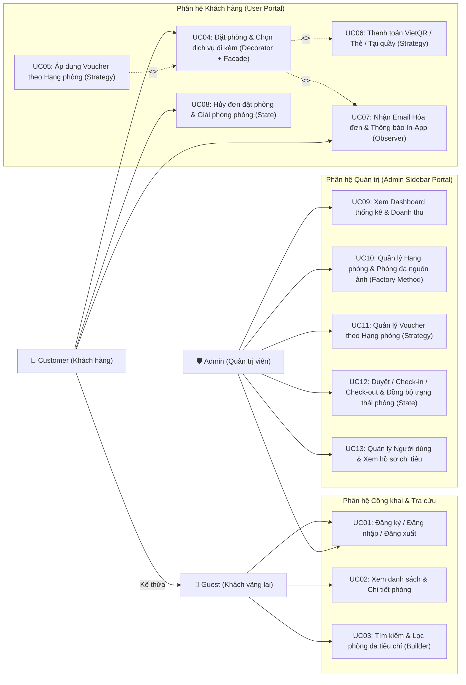
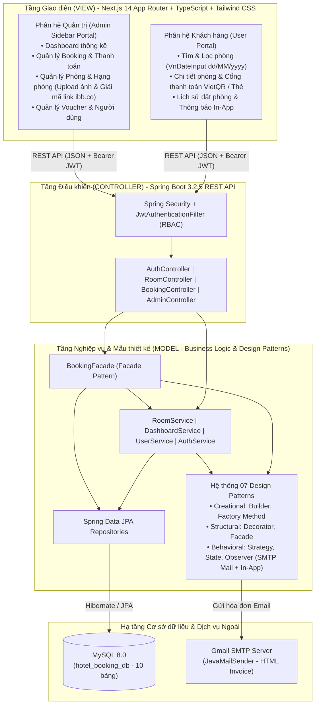
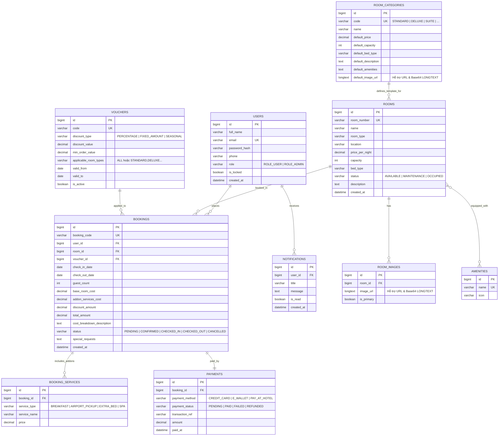
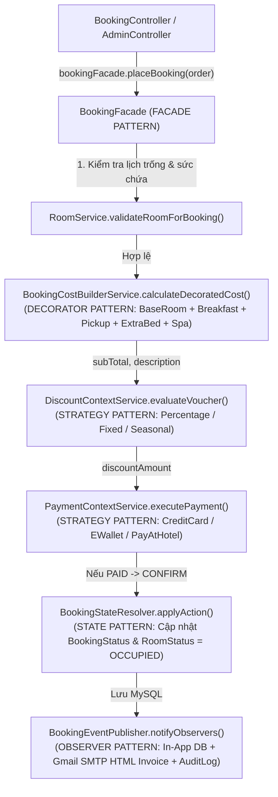
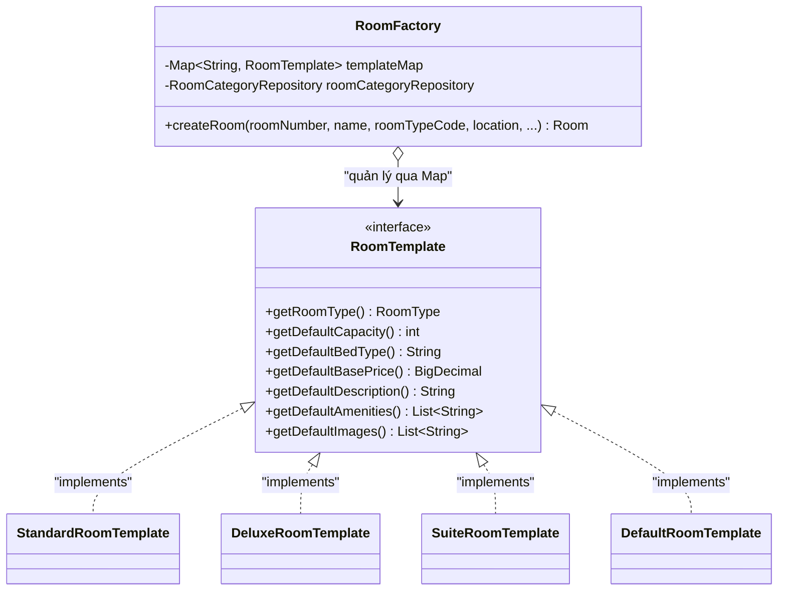
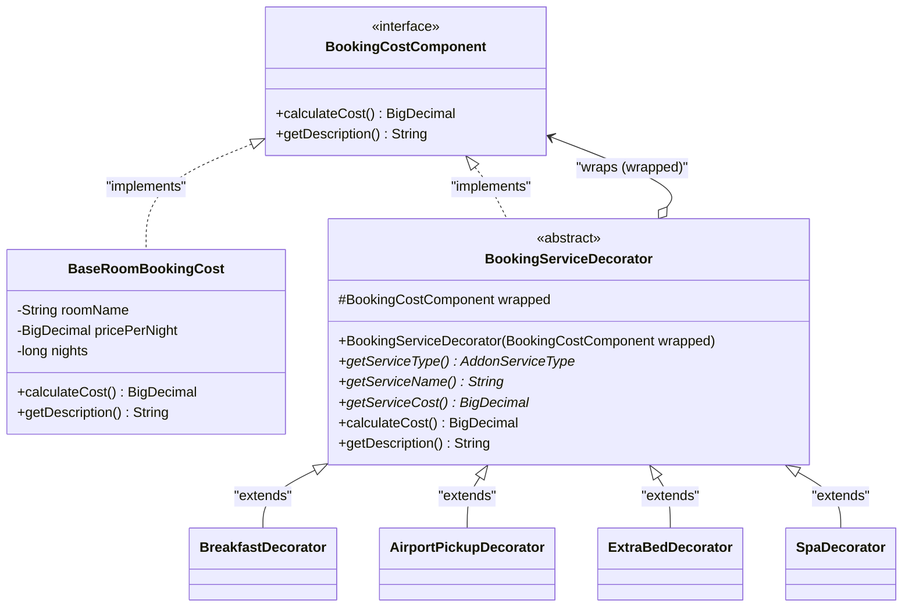
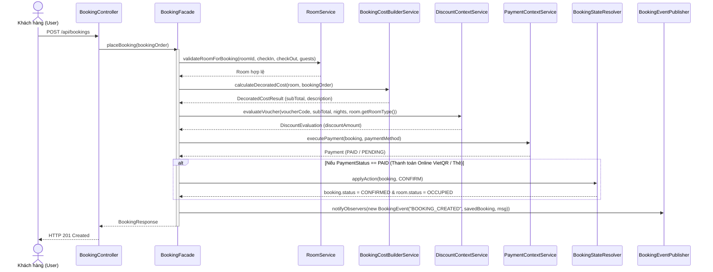

# BÁO CÁO ĐỒ ÁN MÔN HỌC: MẪU THIẾT KẾ PHẦN MỀM (DESIGN PATTERNS)
## ĐỀ TÀI: HỆ THỐNG QUẢN LÝ ĐẶT PHÒNG KHÁCH SẠN TRỰC TUYẾN (HOTEL BOOKING MANAGEMENT SYSTEM)

- **Kiến trúc & Công nghệ sử dụng**:
  - **Backend (`Controller` & `Model`)**: Java 17/21, Spring Boot 3.2.5 (Spring Web MVC, Spring Data JPA, Spring Security + JWT, Spring Mail SMTP `JavaMailSender`, Bean Validation).
  - **Frontend (`View`)**: Next.js 14 (App Router), TypeScript (Strict Mode), Tailwind CSS (Giao diện User Portal & Admin Portal có Sidebar độc lập, bộ chọn lịch chuẩn Việt Nam `dd/MM/yyyy` `VnDateInput`, cổng thanh toán trực tuyến VietQR & Thẻ Sandbox).
  - **Cơ sở dữ liệu**: MySQL 8.0 (`hotel_booking_db` — 10 bảng chuẩn hóa 3NF, hỗ trợ lưu trữ hình ảnh đa nguồn `LONGTEXT`).
  - **Kiểm thử tự động**: JUnit 5 & Spring Boot Integration Test (`DesignPatternsIntegrationTest`).
- **Số lượng Design Patterns hiện thực hóa**: **07 mẫu thiết kế** bao phủ đầy đủ 3 nhóm GoF (*Gang of Four*):
  1. **Nhóm Khởi tạo — Creational Patterns (02 mẫu)**: *Builder Pattern*, *Factory Method Pattern*.
  2. **Nhóm Cấu trúc — Structural Patterns (02 mẫu)**: *Decorator Pattern*, *Facade Pattern*.
  3. **Nhóm Hành vi — Behavioral Patterns (03 mẫu)**: *Strategy Pattern*, *State Pattern*, *Observer Pattern*.

---

## MỤC LỤC BÁO CÁO
1. **CHƯƠNG I: TỔNG QUAN VỀ ĐỀ TÀI VÀ BÀI TOÁN THỰC TẾ**
   - 1.1. Bối cảnh thực tế, Mục tiêu và Phạm vi đề tài
   - 1.2. Phân tích bài toán nghiệp vụ & Lý do cần áp dụng Design Patterns + SOLID
   - 1.3. Đặc tả Yêu cầu Chức năng (FR) & Phi chức năng (NFR)
   - 1.4. Sơ đồ Use Case Tổng quát & Đặc tả chi tiết các Ca sử dụng cốt lõi
2. **CHƯƠNG II: CƠ SỞ LÝ THUYẾT VÀ KIẾN TRÚC HỆ THỐNG**
   - 2.1. Cơ sở lý thuyết 3 nhóm Design Patterns (GoF)
   - 2.2. Phân tích chuyên sâu 5 nguyên lý SOLID áp dụng trong mã nguồn dự án
   - 2.3. Kiến trúc tổng thể hệ thống MVC tách rời (Decoupled Client–Server)
   - 2.4. Thiết kế Cơ sở dữ liệu quan hệ (ERD 10 bảng chuẩn 3NF trên MySQL 8.0)
3. **CHƯƠNG III: PHÂN TÍCH VÀ THIẾT KẾ CHI TIẾT CÁC MẪU THIẾT KẾ ÁP DỤNG**
   - 3.1. Bảng ánh xạ tổng hợp 07 Design Patterns vào các tính năng nghiệp vụ
   - 3.2. Sơ đồ Luồng xử lý (Workflow) của từng nhóm Design Patterns
   - 3.3. Mẫu 1 (Creational): *Builder Pattern* (`BookingOrder`, `RoomSearchCriteria`)
   - 3.4. Mẫu 2 (Creational): *Factory Method Pattern* (`RoomFactory`, `RoomTemplate`, `RoomCategory`)
   - 3.5. Mẫu 3 (Structural): *Decorator Pattern* (`BookingCostComponent`, `BookingServiceDecorator`)
   - 3.6. Mẫu 4 (Structural): *Facade Pattern* (`BookingFacade`)
   - 3.7. Mẫu 5 (Behavioral): *Strategy Pattern* (`DiscountStrategy`, `PaymentStrategy`)
   - 3.8. Mẫu 6 (Behavioral): *State Pattern* (`BookingState`, `BookingStateResolver` & Đồng bộ trạng thái phòng)
   - 3.9. Mẫu 7 (Behavioral): *Observer Pattern* (`BookingObserver`, `EmailNotificationObserver` SMTP & In-App)
4. **CHƯƠNG IV: CÀI ĐẶT, THỬ NGHIỆM VÀ ĐÁNH GIÁ KẾT QUẢ**
   - 4.1. Cấu trúc thư mục dự án & Hướng dẫn cài đặt, vận hành hệ thống
   - 4.2. Các tính năng thực tế nổi bật đã hoàn thiện và nâng cấp
   - 4.3. Bộ 12 Kịch bản Kiểm thử thực nghiệm (Test Cases) & Kết quả JUnit 5
   - 4.4. Bảng so sánh Ưu/Nhược điểm khi áp dụng Design Patterns & Đánh giá kết quả

---

## CHƯƠNG I: TỔNG QUAN VỀ ĐỀ TÀI VÀ BÀI TOÁN THỰC TẾ

### 1.1. Bối cảnh thực tế, Mục tiêu và Phạm vi đề tài

#### A. Bối cảnh thực tế
Trong lĩnh vực kinh doanh dịch vụ lưu trú (*Hospitality & Hotel Management*), quy trình vận hành của một khách sạn hiện đại không chỉ dừng lại ở việc lưu trữ danh sách phòng tĩnh mà đòi hỏi sự phối hợp chặt chẽ, tức thời giữa nhiều nghiệp vụ động:
- Khách hàng tìm kiếm phòng trống theo nhiều tiêu chí kết hợp (địa điểm, hạng phòng, số lượng khách, ngân sách tối thiểu/tối đa, ngày nhận và trả phòng định dạng `dd/MM/yyyy`).
- Khách hàng tùy chọn linh hoạt các dịch vụ tiện ích đi kèm (*Buffet sáng, Xe đưa đón sân bay, Giường phụ, Spa*), áp dụng các chương trình khuyến mãi (Voucher theo mùa, theo phần trăm hoặc tiền mặt có giới hạn theo từng hạng phòng) và thanh toán qua nhiều kênh (Quét mã QR Ví điện tử VietQR, Thẻ tín dụng quốc tế hoặc Thanh toán tại khách sạn).
- Hệ thống phải tự động kiểm soát vòng đời trạng thái của đơn đặt phòng (`PENDING` $\rightarrow$ `CONFIRMED` $\rightarrow$ `CHECKED_IN` $\rightarrow$ `CHECKED_OUT` / `CANCELLED`), đồng bộ tức thời với **trạng thái vật lý của phòng** (`AVAILABLE` $\leftrightarrow$ `OCCUPIED`) và gửi hóa đơn điện tử qua Email + thông báo trên ứng dụng cho khách hàng.

#### B. Mục tiêu của đề tài
1. **Về mặt công nghệ & kiến trúc**: Xây dựng hệ thống Web Full-Stack hoàn chỉnh theo kiến trúc **MVC tách rời (Decoupled Client–Server)** sử dụng **Spring Boot 3.2.5 RESTful API + MySQL 8.0** ở tầng Backend và **Next.js 14 (App Router) + TypeScript + Tailwind CSS** ở tầng Frontend.
2. **Về mặt kỹ thuật phần mềm**: Vận dụng chuẩn xác **5 nguyên lý SOLID** và **07 mẫu thiết kế (Design Patterns)** thuộc cả 3 nhóm *Creational, Structural, Behavioral* để giải quyết các bài toán nghiệp vụ thực tế, loại bỏ mã nguồn phụ thuộc chặt (*Tight Coupling*) và các cấu trúc rẽ nhánh `if-else` / `switch-case` phức tạp.

#### C. Phạm vi đề tài & Đối tượng người dùng (Actors)
Hệ thống phục vụ 3 nhóm tác nhân chính:
1. **Guest (Khách vãng lai)**:
   - Tra cứu danh sách phòng, lọc đa tiêu chí (Từ khóa, Địa điểm, Hạng phòng, Số khách, Khoảng giá `minPrice` – `maxPrice`, Ngày nhận/trả phòng `dd/MM/yyyy`).
   - Xem chi tiết từng phòng, bộ sưu tập hình ảnh, loại giường, sức chứa, tiện nghi và bảng tạm tính chi phí trực tiếp (*Live Price Breakdown*).
   - Đăng ký tài khoản mới và đăng nhập.
2. **Customer / User (Khách hàng thành viên)**:
   - Thực hiện đặt phòng trực tuyến, tích chọn tổ hợp dịch vụ phụ trợ (*Add-on Services*), áp dụng mã giảm giá (*Voucher*).
   - Trải nghiệm **Cổng thanh toán trực tuyến mô phỏng (Online Payment Gateway Modal)**: Quét mã **VietQR động** hiển thị đúng số tiền & mã phòng đối với Ví điện tử (`E_WALLET`) hoặc nhập thông tin thẻ trên cổng **Sandbox Visa/Mastercard** đối với Thẻ tín dụng (`CREDIT_CARD`), hoặc chọn Thanh toán tại quầy (`PAY_AT_HOTEL`).
   - Nhận **Email hóa đơn xác nhận định dạng HTML** gửi trực tiếp vào hộp thư cá nhân và thông báo thời gian thực trên hệ thống (*In-App Notification*).
   - Quản lý lịch sử đặt phòng cá nhân, xem bóc tách chi phí và chủ động hủy đơn khi đơn ở trạng thái cho phép (`PENDING` hoặc `CONFIRMED`).
3. **Administrator (Quản trị viên hệ thống)**:
   - Quản trị toàn diện qua **Admin Portal độc lập có Sidebar bên trái** gồm 6 phân hệ:
     1. **Dashboard Tổng quan**: Thống kê doanh thu, số lượng phòng theo trạng thái, phân bổ đơn đặt phòng theo vòng đời *State Pattern* và danh sách giao dịch mới nhất.
     2. **Quản lý Booking & Thanh toán**: Duyệt đơn (`CONFIRM`), Nhận phòng (`CHECK_IN`), Trả phòng (`CHECK_OUT`), Hủy đơn (`CANCEL`) và cập nhật trạng thái thanh toán (`PAID`, `PENDING`, `REFUNDED`).
     3. **Quản lý Phòng**: Thêm/Sửa/Xóa/Lọc phòng khách sạn; tự động kế thừa cấu hình chuẩn từ Hạng phòng qua *Factory Method Pattern*; hỗ trợ tải ảnh trực tiếp từ máy tính (không giới hạn độ phân giải/MP, tự động tối ưu qua HTML5 Canvas) hoặc dán link chia sẻ bất kỳ (`ibb.co`, `imgur.com`, `drive.google.com`...) kèm ảnh xem trước.
     4. **Quản lý Hạng phòng**: Thêm/Sửa/Xóa các hạng phòng (`STANDARD`, `DELUXE`, `SUITE`, `VIP_VILLA`...), đồng bộ trực tiếp sang chức năng Tạo phòng và Voucher.
     5. **Quản lý Voucher**: Thêm/Sửa/Xóa mã giảm giá theo 3 chiến lược (`PERCENTAGE`, `FIXED_AMOUNT`, `SEASONAL`) và cấu hình phạm vi áp dụng cho tất cả phòng (`ALL`) hoặc từng hạng phòng cụ thể.
     6. **Quản lý Người dùng**: Thêm/Sửa/Xóa tài khoản, phân quyền `ROLE_USER` / `ROLE_ADMIN`, khóa/mở khóa tài khoản và xem hồ sơ chi tiết kèm lịch sử chi tiêu của từng khách hàng.

---

### 1.2. Phân tích bài toán nghiệp vụ & Lý do cần áp dụng Design Patterns + SOLID

Trong quá trình phân tích bài toán thực tế, có **4 thách thức thiết kế lớn** nếu chỉ lập trình theo cách thông thường:

1. **Thách thức 1 — Khởi tạo các đối tượng có nhiều tham số tùy chọn và cấu hình mẫu theo phân loại**:
   - Yêu cầu tìm kiếm phòng (`RoomSearchCriteria`) và yêu cầu đặt phòng (`BookingOrder`) có từ 8–9 thuộc tính (nhiều thuộc tính có thể `null`). Dùng Constructor truyền thống sẽ dẫn đến *Telescoping Constructor Anti-pattern*, dễ truyền nhầm thứ tự tham số cùng kiểu (`checkInDate` và `checkOutDate`).
   - Khi Admin tạo phòng mới theo Hạng phòng (`STANDARD`, `DELUXE`, `SUITE` hoặc hạng phòng mới tạo), việc dùng `if-else` để gán giá mặc định, sức chứa, loại giường, tiện nghi sẽ làm `RoomService` bị sửa đổi liên tục mỗi khi khách sạn thêm hạng phòng mới.
   - $\Rightarrow$ **Giải pháp**: Áp dụng **Builder Pattern** và **Factory Method Pattern** (Nhóm *Creational*).

2. **Thách thức 2 — Tính toán chi phí cộng dồn linh hoạt và điều phối quy trình phức tạp**:
   - Khách hàng có thể chọn $0, 1$ hoặc nhiều dịch vụ đi kèm (*Buffet sáng, Đưa đón sân bay, Giường phụ, Spa*). Nếu dùng kế thừa tĩnh sẽ tạo ra $2^4 = 16$ lớp con (*Class Explosion*).
   - Quy trình đặt phòng cần phối hợp 6 hệ thống con: Kiểm tra phòng trống $\rightarrow$ Tính giá phòng & dịch vụ $\rightarrow$ Tính giảm giá Voucher $\rightarrow$ Xử lý thanh toán $\rightarrow$ Chuyển trạng thái đơn & phòng $\rightarrow$ Phát thông báo đa kênh.
   - $\Rightarrow$ **Giải pháp**: Áp dụng **Decorator Pattern** và **Facade Pattern** (Nhóm *Structural*).

3. **Thách thức 3 — Sự biến thiên của thuật toán tính khuyến mãi và phương thức thanh toán**:
   - Các loại Voucher (`PERCENTAGE`, `FIXED_AMOUNT`, `SEASONAL`) và phương thức thanh toán (`CREDIT_CARD`, `E_WALLET`, `PAY_AT_HOTEL`) có công thức và quy trình xử lý hoàn toàn khác nhau. Nếu nhồi nhét vào một hàm `switch-case` sẽ vi phạm nguyên lý Đóng/Mở (**OCP**).
   - $\Rightarrow$ **Giải pháp**: Áp dụng **Strategy Pattern** (Nhóm *Behavioral*).

4. **Thách thức 4 — Kiểm soát trạng thái đơn đặt phòng chặt chẽ, đồng bộ trạng thái phòng và thông báo đa kênh**:
   - Đơn đặt phòng chỉ được chuyển trạng thái theo luồng hợp lệ (ví dụ: không thể hủy đơn khi khách đã `CHECKED_IN`, không thể `CHECK_IN` khi đơn đã `CANCELLED`), đồng thời phải tự động khóa phòng (`OCCUPIED`) khi xác nhận/nhận phòng và giải phóng phòng (`AVAILABLE`) khi trả phòng/hủy đơn.
   - Mỗi biến động trạng thái cần thông báo đồng thời qua Web (*In-App*), gửi *Email HTML* qua SMTP và ghi *Audit Log* mà không làm phình to lớp nghiệp vụ chính.
   - $\Rightarrow$ **Giải pháp**: Áp dụng **State Pattern** và **Observer Pattern** (Nhóm *Behavioral*).

---

### 1.3. Đặc tả Yêu cầu Chức năng (FR) & Phi chức năng (NFR)

#### A. Bảng Yêu cầu Chức năng (Functional Requirements)

| Mã YC | Phân hệ | Tên chức năng | Mô tả chi tiết nghiệp vụ | Design Pattern áp dụng |
| :--- | :--- | :--- | :--- | :--- |
| **FR-U01** | User | Đăng ký / Đăng nhập / Đăng xuất | Xác thực JWT Stateless, mã hóa mật khẩu BCrypt, kiểm tra trạng thái khóa tài khoản (`isLocked`). | — |
| **FR-U02** | User | Tìm kiếm & Lọc phòng đa tiêu chí | Lọc theo từ khóa, địa điểm, hạng phòng, số khách, khoảng giá (`minPrice` - `maxPrice`) và ngày nhận/trả (`dd/MM/yyyy`). Tự động loại trừ phòng trùng lịch. | **Builder Pattern** (`RoomSearchCriteria`) |
| **FR-U03** | User | Xem chi tiết phòng & Báo giá trực tiếp | Xem thông tin phòng, tiện nghi, chọn ngày ở & dịch vụ đi kèm để xem bảng bóc tách chi phí trực tiếp (*Live Preview*). | **Decorator Pattern**, **Facade Pattern** |
| **FR-U04** | User | Đặt phòng & Chọn dịch vụ phụ trợ | Tích chọn linh hoạt *Buffet sáng, Đưa đón sân bay, Giường phụ, Spa*; tự động bọc chi phí và tạo mô tả hóa đơn chi tiết. | **Builder Pattern** (`BookingOrder`), **Decorator Pattern** (`BookingCostComponent`) |
| **FR-U05** | User | Áp dụng mã giảm giá (Voucher) | Kiểm tra thời hạn, giá trị đơn tối thiểu, phạm vi hạng phòng áp dụng và tính tiền giảm theo `%`, cố định hoặc mùa lễ. | **Strategy Pattern** (`DiscountStrategy`) |
| **FR-U06** | User | Thanh toán qua Cổng Online / Tại quầy | Hiển thị Modal quét mã **VietQR** (`E_WALLET`), nhập thẻ **Visa/Mastercard Sandbox** (`CREDIT_CARD`) hoặc trả tại khách sạn (`PAY_AT_HOTEL`). | **Strategy Pattern** (`PaymentStrategy`), **Facade Pattern** |
| **FR-U07** | User | Nhận Email Hóa đơn & Quản lý Booking | Nhận Email xác nhận HTML qua SMTP & thông báo In-App; xem lịch sử đặt phòng và hủy đơn hợp lệ. | **State Pattern**, **Observer Pattern** |
| **FR-A01** | Admin | Xem Dashboard thống kê | Thống kê doanh thu thực tế, số phòng sẵn sàng/bảo trì, phân bổ trạng thái đơn đặt phòng và danh sách đơn mới nhất. | — |
| **FR-A02** | Admin | Quản lý Hạng phòng & Phòng (Đa nguồn ảnh) | CRUD Hạng phòng & Phòng; kế thừa thông số chuẩn từ Hạng phòng; tải ảnh từ máy tính (`LONGTEXT`) hoặc dán link `ibb.co`, `imgur`, `Google Drive`. | **Factory Method Pattern** (`RoomFactory`, `RoomTemplate`) |
| **FR-A03** | Admin | Quản lý Voucher theo Hạng phòng | CRUD mã giảm giá; cấu hình phạm vi áp dụng cho tất cả phòng (`ALL`) hoặc danh sách hạng phòng cụ thể. | **Strategy Pattern** (`DiscountContextService`) |
| **FR-A04** | Admin | Quản lý Booking & Đồng bộ trạng thái phòng | Duyệt đơn (`CONFIRM`), Nhận phòng (`CHECK_IN`), Trả phòng (`CHECK_OUT`), Hủy đơn (`CANCEL`); tự động đồng bộ `RoomStatus` (`OCCUPIED` $\leftrightarrow$ `AVAILABLE`). | **Facade Pattern**, **State Pattern**, **Observer Pattern** |
| **FR-A05** | Admin | Quản lý Người dùng toàn diện | Thêm/Sửa/Xóa User, phân quyền `ROLE_USER`/`ROLE_ADMIN`, khóa/mở khóa tài khoản, xem lịch sử đặt phòng & tổng chi tiêu của từng User. | — |

#### B. Yêu cầu Phi chức năng (Non-Functional Requirements)
1. **Tính toàn vẹn giao dịch (ACID & Concurrency Control)**: Mọi thao tác đặt phòng và chuyển đổi trạng thái được bao bọc trong `@Transactional`, kiểm tra chồng lấn ngày ở (`checkInDate < existingCheckOut AND checkOutDate > existingCheckIn`) để chống đặt trùng phòng (*Double Booking*).
2. **Chuẩn hóa bản địa hóa Việt Nam**: Toàn bộ ô chọn ngày (`VnDateInput`) và hiển thị ngày tháng trên hệ thống tuân thủ định dạng **Ngày/Tháng/Năm (`dd/MM/yyyy`)**, tiền tệ định dạng **VNĐ**.
3. **Bảo mật (Security)**: Phân quyền RBAC qua Spring Security + JWT Filter (`/api/admin/**` yêu cầu `ROLE_ADMIN`).
4. **Độ mở rộng & Bảo trì (Extensibility)**: Tuân thủ 5 nguyên lý SOLID; tra cứu các chiến lược/trạng thái qua `Map` với độ phức tạp $O(1)$.

---

### 1.4. Sơ đồ Use Case Tổng quát & Đặc tả chi tiết các Ca sử dụng cốt lõi



---

## CHƯƠNG II: CƠ SỞ LÝ THUYẾT VÀ KIẾN TRÚC HỆ THỐNG

### 2.1. Cơ sở lý thuyết 3 nhóm Design Patterns (GoF)

Theo cuốn sách kinh điển *"Design Patterns: Elements of Reusable Object-Oriented Software"* của nhóm tác giả **Gang of Four (GoF)**, các mẫu thiết kế hướng đối tượng được chia thành 3 nhóm chính:

1. **Nhóm Khởi tạo (Creational Patterns)**:
   - **Mục đích**: Trừu tượng hóa quá trình khởi tạo đối tượng (`instantiation`), giúp hệ thống độc lập với cách các đối tượng của nó được tạo ra, lắp ráp và biểu diễn.
   - **Áp dụng trong dự án**:
     - *Builder Pattern*: Tách rời việc xây dựng đối tượng phức tạp (`BookingOrder`, `RoomSearchCriteria`) khỏi biểu diễn của nó.
     - *Factory Method Pattern*: Định nghĩa giao diện tạo đối tượng (`RoomFactory`, `RoomTemplate`), tự động hóa việc cấu hình thực thể `Room` theo từng hạng phòng.
2. **Nhóm Cấu trúc (Structural Patterns)**:
   - **Mục đích**: Giải quyết bài toán kết hợp các lớp và đối tượng để tạo nên các cấu trúc lớn hơn mà vẫn đảm bảo tính mềm dẻo và hiệu quả.
   - **Áp dụng trong dự án**:
     - *Decorator Pattern*: Gắn thêm trách nhiệm (chi phí và mô tả dịch vụ phụ trợ) vào đối tượng tiền phòng gốc (`BaseRoomBookingCost`) một cách linh hoạt lúc runtime.
     - *Facade Pattern*: Cung cấp giao diện thống nhất bậc cao (`BookingFacade`) cho một tập hợp các giao diện trong hệ thống con.
3. **Nhóm Hành vi (Behavioral Patterns)**:
   - **Mục đích**: Tập trung vào thuật toán và sự phân chia trách nhiệm, giao tiếp giữa các đối tượng.
   - **Áp dụng trong dự án**:
     - *Strategy Pattern*: Đóng gói họ thuật toán tính giảm giá (`DiscountStrategy`) và thanh toán (`PaymentStrategy`), cho phép hoán đổi linh hoạt lúc runtime.
     - *State Pattern*: Cho phép đối tượng `Booking` thay đổi hành vi khi trạng thái nội tại của nó thay đổi (`PendingState`, `ConfirmedState`, `CheckedInState`...), đồng thời đồng bộ trạng thái phòng.
     - *Observer Pattern*: Định nghĩa sự phụ thuộc một-nhiều giữa `BookingEventPublisher` và các kênh thông báo (`InAppNotificationObserver`, `EmailNotificationObserver`, `AuditLogObserver`).

---

### 2.2. Phân tích chuyên sâu 5 nguyên lý SOLID áp dụng trong mã nguồn dự án

#### 1. Nguyên lý S — Single Responsibility Principle (Nguyên lý Đơn trách nhiệm)
- **Nội dung**: Một lớp chỉ nên giữ một trách nhiệm duy nhất và chỉ có một lý do duy nhất để thay đổi.
- **Hiện thực trong dự án**:
  - `RoomService`: Chuyên trách quản lý danh mục phòng, hạng phòng, chuẩn hóa đường dẫn hình ảnh (`normalizeImageUrl`) và kiểm tra xung đột lịch đặt phòng.
  - `BookingCostBuilderService`: Chuyên trách lắp ghép chuỗi `BookingServiceDecorator` để tính giá phòng và dịch vụ phụ trợ.
  - `DiscountContextService`: Chuyên trách kiểm tra tính hợp lệ của Voucher (hạn dùng, giá trị tối thiểu, hạng phòng áp dụng) và gọi chiến lược giảm giá.
  - `PaymentContextService`: Chuyên trách điều phối giao dịch thanh toán.
  - `BookingStateResolver`: Chuyên trách kiểm soát chuyển đổi trạng thái đơn đặt phòng.
  - `EmailNotificationObserver`: Chuyên trách định dạng và gửi Email hóa đơn xác nhận qua SMTP (`JavaMailSender`).

#### 2. Nguyên lý O — Open/Closed Principle (Nguyên lý Đóng/Mở)
- **Nội dung**: Các module phần mềm nên **mở cho việc mở rộng** (*Open for extension*) nhưng **đóng cho việc sửa đổi** (*Closed for modification*).
- **Hiện thực trong dự án**:
  - Trong `DiscountContextService`, toàn bộ các bean thực thi `DiscountStrategy` được Spring tự động gom vào `Map<DiscountType, DiscountStrategy>` qua Constructor Injection:
    ```java
    public DiscountContextService(List<DiscountStrategy> strategies, VoucherRepository voucherRepository) {
        this.strategyMap = strategies.stream()
                .collect(Collectors.toMap(DiscountStrategy::getDiscountType, Function.identity()));
        this.voucherRepository = voucherRepository;
    }
    ```
  - Khi cần thêm chiến lược giảm giá mới (ví dụ: *VIPMemberDiscountStrategy*) hoặc kênh thông báo mới (ví dụ: *SmsNotificationObserver*), ta chỉ cần tạo class mới thực thi interface tương ứng mà **không cần sửa bất kỳ dòng code nào** trong các lớp hiện có.

#### 3. Nguyên lý L — Liskov Substitution Principle (Nguyên lý Thay thế Liskov)
- **Nội dung**: Các đối tượng của lớp dẫn xuất (*Subtype*) có thể thay thế hoàn toàn cho lớp cơ sở/giao diện (*Supertype*) mà không làm sai lệch hành vi đúng đắn của chương trình.
- **Hiện thực trong dự án**:
  - Mọi lớp bọc dịch vụ (`BreakfastDecorator`, `AirportPickupDecorator`, `ExtraBedDecorator`, `SpaDecorator`) đều kế thừa `BookingServiceDecorator` và thực thi `BookingCostComponent`. Khi `BookingCostBuilderService` gọi `component.calculateCost()`, bất kể đối tượng bên dưới là `BaseRoomBookingCost` hay đã được bọc qua 4 tầng Decorator, phương thức luôn trả về số tiền hợp lệ ($\ge 0$) mà không cần ép kiểu hay kiểm tra `instanceof`.

#### 4. Nguyên lý I — Interface Segregation Principle (Nguyên lý Phân tách Giao diện)
- **Nội dung**: Nhiều giao diện nhỏ, chuyên biệt tốt hơn một giao diện lớn cồng kềnh; không ép Client phụ thuộc vào các phương thức mà nó không dùng.
- **Hiện thực trong dự án**:
  - Hệ thống tách biệt thành 6 interface nhỏ gọn, mỗi interface chỉ chứa từ 1 đến 5 phương thức đúng mục đích:
    - `BookingObserver` (1 phương thức `onBookingEvent`),
    - `BookingCostComponent` (2 phương thức `calculateCost`, `getDescription`),
    - `DiscountStrategy` (2 phương thức),
    - `PaymentStrategy` (2 phương thức),
    - `BookingState` (5 phương thức vòng đời trạng thái),
    - `RoomTemplate` (7 phương thức cấu hình mẫu hạng phòng).

#### 5. Nguyên lý D — Dependency Inversion Principle (Nguyên lý Đảo ngược Phụ thuộc)
- **Nội dung**: Module cấp cao không phụ thuộc vào module cấp thấp; cả hai cùng phụ thuộc vào *Abstraction* (interface).
- **Hiện thực trong dự án**:
  - `BookingFacade`, `DiscountContextService`, `PaymentContextService`, `BookingEventPublisher` chỉ tham chiếu tới các interface (`DiscountStrategy`, `PaymentStrategy`, `BookingState`, `BookingObserver`, `BookingRepository`), tuyệt đối không khởi tạo cứng (`new`) các lớp dịch vụ cấp thấp.

---

### 2.3. Kiến trúc tổng thể hệ thống MVC tách rời (Decoupled Client–Server)



---

### 2.4. Thiết kế Cơ sở dữ liệu quan hệ (ERD 10 bảng chuẩn 3NF trên MySQL 8.0)



---

## CHƯƠNG III: PHÂN TÍCH VÀ THIẾT KẾ CHI TIẾT CÁC MẪU THIẾT KẾ ÁP DỤNG

### 3.1. Bảng ánh xạ tổng hợp 07 Design Patterns vào các tính năng nghiệp vụ

| Nhóm Pattern | Tên Mẫu thiết kế | Các lớp (Classes) cài đặt trong Source Code | Tính năng Nghiệp vụ áp dụng trong Hệ thống |
| :--- | :--- | :--- | :--- |
| **1. Creational**<br>*(Khởi tạo)* | **1. Builder Pattern** | `RoomSearchCriteria`<br>`RoomSearchCriteria.Builder`<br>`BookingOrder`<br>`BookingOrder.Builder` | • **Tìm kiếm & Lọc phòng đa tiêu chí**: Đóng gói 9 tiêu chí tìm kiếm tùy chọn.<br>• **Đặt phòng trực tuyến**: Khởi tạo đối tượng đơn đặt phòng bất biến (*Immutable*) từng bước và tự động kiểm tra ràng buộc ngày ở (`checkOut > checkIn`), số khách tại `.build()`. |
| **1. Creational**<br>*(Khởi tạo)* | **2. Factory Method Pattern** | `RoomTemplate` *(Interface)*<br>`StandardRoomTemplate`<br>`DeluxeRoomTemplate`<br>`SuiteRoomTemplate`<br>`DefaultRoomTemplate`<br>`RoomFactory`<br>`RoomCategory` | • **Quản lý Phòng & Hạng phòng (Admin thêm phòng mới)**: Khi Admin chọn Hạng phòng (`STANDARD`, `DELUXE`, `SUITE` hoặc hạng phòng động mới tạo), `RoomFactory` tự động tra cứu cấu hình chuẩn và sản xuất thực thể `Room` hoàn chỉnh kèm tiện nghi & hình ảnh. |
| **2. Structural**<br>*(Cấu trúc)* | **3. Decorator Pattern** | `BookingCostComponent`<br>`BaseRoomBookingCost`<br>`BookingServiceDecorator`<br>`BreakfastDecorator`<br>`AirportPickupDecorator`<br>`ExtraBedDecorator`<br>`SpaDecorator`<br>`BookingCostBuilderService` | • **Chọn dịch vụ đi kèm & Báo giá trực tiếp khi đặt phòng**: Cho phép khách hàng tích chọn linh hoạt các dịch vụ phụ trợ (*Buffet sáng, Xe đưa đón sân bay, Giường phụ, Spa*), tự động bọc lồng nhau để cộng dồn chi phí và sinh chuỗi mô tả chi tiết hóa đơn. |
| **2. Structural**<br>*(Cấu trúc)* | **4. Facade Pattern** | `BookingFacade` | • **Điều phối trọn gói Đặt phòng, Báo giá & Chuyển trạng thái**: Cung cấp một mặt tiền giao tiếp duy nhất cho `BookingController` và `AdminController`, điều phối 6 hệ thống con bên dưới và tự động giải phóng phòng khi khách trả phòng/hủy đơn. |
| **3. Behavioral**<br>*(Hành vi)* | **5. Strategy Pattern** | • *Giảm giá*: `DiscountStrategy`, `PercentageDiscountStrategy`, `FixedAmountDiscountStrategy`, `SeasonalDiscountStrategy`, `DiscountContextService`<br>• *Thanh toán*: `PaymentStrategy`, `CreditCardPaymentStrategy`, `EWalletPaymentStrategy`, `PayAtHotelPaymentStrategy`, `PaymentContextService` | • **Áp dụng Voucher theo Hạng phòng**: Kiểm tra điều kiện Hạng phòng (`ALL` hoặc hạng phòng cụ thể) và tính giảm giá theo %, tiền cố định hoặc mùa lễ (+5% nếu ở $\ge 3$ đêm).<br>• **Thanh toán đa phương thức**: Xử lý thanh toán qua Thẻ tín dụng, Ví điện tử hoặc Thanh toán tại khách sạn. |
| **3. Behavioral**<br>*(Hành vi)* | **6. State Pattern** | `BookingState` *(Interface)*<br>`PendingState`<br>`ConfirmedState`<br>`CheckedInState`<br>`CheckedOutState`<br>`CancelledState`<br>`BookingStateResolver` | • **Quản lý vòng đời trạng thái đơn & Đồng bộ trạng thái phòng**: Kiểm soát chặt chẽ các hành động `CONFIRM`, `CHECK_IN`, `CHECK_OUT`, `CANCEL`. Tự động chuyển phòng sang `OCCUPIED` khi xác nhận/nhận phòng và giải phóng về `AVAILABLE` khi trả phòng/hủy đơn. |
| **3. Behavioral**<br>*(Hành vi)* | **7. Observer Pattern** | `BookingObserver` *(Interface)*<br>`InAppNotificationObserver`<br>`EmailNotificationObserver`<br>`AuditLogObserver`<br>`BookingEventPublisher`<br>`BookingEvent` | • **Thông báo tự động đa kênh & Gửi Email Hóa đơn thực tế**: Khi phát sinh sự kiện đặt phòng, chuyển trạng thái hoặc hủy đơn, hệ thống tự động lưu thông báo *In-App*, gửi **Email HTML** qua Gmail SMTP (`JavaMailSender`) và ghi *Audit Log*. |

---

### 3.2. Sơ đồ Luồng xử lý (Workflow) của từng nhóm Design Patterns

#### A. Luồng xử lý Nhóm Creational (Builder & Factory Method)

```mermaid
flowchart TB
    subgraph Flow_Builder["1. Luồng xử lý Builder Pattern (Tìm kiếm phòng & Đặt phòng)"]
        B_Start["Người dùng nhập thông tin trên Giao diện\n(Bộ lọc tìm kiếm HOẶC Form Đặt phòng)"] --> B_Init["Controller khởi tạo Builder\nRoomSearchCriteria.builder() / BookingOrder.builder()"]
        B_Init --> B_Chain["Gán chuỗi thuộc tính tùy chọn (Fluent API)\n.roomId().dates(in, out).guestCount()\n.addonServices().voucherCode().paymentMethod()"]
        B_Chain --> B_Build["Gọi phương thức .build()"]
        B_Build --> B_Val{"Kiểm tra ràng buộc\ntrong validate()"}
        B_Val -->|"Vi phạm (checkOut <= checkIn\nhoặc guestCount <= 0)"| B_Err["Ném BusinessRuleException\nBáo lỗi tiếng Việt rõ ràng"]
        B_Val -->|"Hợp lệ"| B_Done["Trả về đối tượng bất biến (Immutable)\nBookingOrder / RoomSearchCriteria"]
    end

    subgraph Flow_Factory["2. Luồng xử lý Factory Method Pattern (Admin Thêm phòng mới)"]
        F_Start["Admin vào Quản lý Phòng\nNhấn '+ Thêm Phòng mới' & chọn Hạng phòng"] --> F_Call["RoomService chuẩn hóa URL ảnh (normalizeImageUrl)\nvà gọi RoomFactory.createRoom(...)"]
        F_Call --> F_Lookup["RoomFactory tra cứu cấu hình từ\nRoomCategory (DB) & RoomTemplate (Map)"]
        F_Lookup --> F_Apply["Tự động áp dụng Giá mặc định, Sức chứa,\nLoại giường, Tiện nghi & Ảnh của Hạng phòng"]
        F_Apply --> F_Custom["Ghi đè các thông số tùy chỉnh (nếu có)\nvà lưu Room vào MySQL"]
    end
```


#### B. Luồng xử lý Nhóm Structural & Behavioral trong Giao dịch Đặt phòng


---

### 3.3. Mẫu 1 (Nhóm Creational): Builder Pattern

#### A. Bài toán thực tế & Lý do lựa chọn
Đối tượng `BookingOrder` (đơn đặt phòng đầu vào) và `RoomSearchCriteria` (bộ lọc tìm kiếm phòng) có tới 9 thuộc tính, trong đó nhiều thuộc tính là tùy chọn (`voucherCode`, `addonServices`, `specialRequests`, `minPrice`, `maxPrice`). Việc áp dụng **Builder Pattern** giúp:
- Tránh hoàn toàn *Telescoping Constructor* (Constructor có 8–9 tham số dễ truyền nhầm thứ tự).
- Đảm bảo đối tượng sau khi tạo ra là **bất biến (Immutable)** (chỉ có `getter`, không có `setter`).
- Tập trung toàn bộ kiểm tra ràng buộc (`checkOutDate` phải sau `checkInDate`, `guestCount >= 1`) tại phương thức `validate()` trước khi tạo đối tượng.

#### B. Sơ đồ Lớp UML (Class Diagram)
```mermaid
classDiagram
    class BookingOrder {
        -final Long userId
        -final Long roomId
        -final LocalDate checkInDate
        -final LocalDate checkOutDate
        -final Integer guestCount
        -final String voucherCode
        -final List~AddonServiceType~ addonServices
        -final PaymentMethodType paymentMethod
        -final String specialRequests
        -BookingOrder(Builder builder)
        +getStayNights() long
        +builder()$ Builder
    }

    class BookingOrder_Builder {
        -Long userId
        -Long roomId
        -LocalDate checkInDate
        -LocalDate checkOutDate
        -Integer guestCount
        -String voucherCode
        -List~AddonServiceType~ addonServices
        -PaymentMethodType paymentMethod
        -String specialRequests
        +userId(Long) Builder
        +roomId(Long) Builder
        +dates(LocalDate, LocalDate) Builder
        +guestCount(Integer) Builder
        +voucherCode(String) Builder
        +addonServices(List~AddonServiceType~) Builder
        +paymentMethod(PaymentMethodType) Builder
        +specialRequests(String) Builder
        -validate() void
        +build() BookingOrder
    }

    class BookingController {
        +createBooking(UserDetails, CreateBookingRequest) ResponseEntity
        +previewBookingPrice(PreviewBookingRequest) ResponseEntity
    }

    BookingController ..> BookingOrder_Builder : "khởi tạo qua Fluent API"
    BookingOrder_Builder ..> BookingOrder : "tạo ra (creates)"
    BookingOrder +-- BookingOrder_Builder : "static inner class"
```

#### C. Minh họa Code thực tế (`BookingOrder.java`)
```java
public final class BookingOrder {
    private final Long userId;
    private final Long roomId;
    private final LocalDate checkInDate;
    private final LocalDate checkOutDate;
    private final Integer guestCount;
    private final String voucherCode;
    private final List<AddonServiceType> addonServices;
    private final PaymentMethodType paymentMethod;
    private final String specialRequests;

    private BookingOrder(Builder builder) {
        this.userId = builder.userId;
        this.roomId = builder.roomId;
        this.checkInDate = builder.checkInDate;
        this.checkOutDate = builder.checkOutDate;
        this.guestCount = builder.guestCount;
        this.voucherCode = builder.voucherCode;
        this.addonServices = Collections.unmodifiableList(new ArrayList<>(builder.addonServices));
        this.paymentMethod = builder.paymentMethod;
        this.specialRequests = builder.specialRequests;
    }

    public long getStayNights() {
        return ChronoUnit.DAYS.between(checkInDate, checkOutDate);
    }

    public static class Builder {
        // ... các phương thức Fluent setter trả về this
        public BookingOrder build() {
            validate();
            return new BookingOrder(this);
        }

        private void validate() {
            if (roomId == null) {
                throw new BusinessRuleException("Phải chọn phòng cần đặt (roomId không được để trống).");
            }
            if (checkInDate == null || checkOutDate == null) {
                throw new BusinessRuleException("Ngày nhận phòng và ngày trả phòng không được để trống.");
            }
            if (!checkOutDate.isAfter(checkInDate)) {
                throw new BusinessRuleException("Ngày trả phòng phải sau ngày nhận phòng ít nhất 1 đêm.");
            }
            if (guestCount == null || guestCount <= 0) {
                throw new BusinessRuleException("Số lượng khách lưu trú phải lớn hơn 0.");
            }
        }
    }
}
```

---

### 3.4. Mẫu 2 (Nhóm Creational): Factory Method Pattern

#### A. Bài toán thực tế & Lý do lựa chọn
Khi Quản trị viên tạo phòng mới theo Hạng phòng (`STANDARD`, `DELUXE`, `SUITE` hoặc hạng phòng mới do Admin tự định nghĩa trong bảng `room_categories`), mỗi hạng phòng có bộ thông số mặc định riêng (giá sàn, sức chứa, loại giường, tiện nghi, hình ảnh). **Factory Method Pattern** (`RoomFactory` + `RoomTemplate`) đóng gói toàn bộ logic khởi tạo này, giúp `RoomService` không chứa bất kỳ câu lệnh `if-else` phân loại hạng phòng nào.

#### B. Sơ đồ Lớp UML (Class Diagram)


#### C. Minh họa Code thực tế (`RoomFactory.java`)
```java
@Component
public class RoomFactory {
    private final Map<String, RoomTemplate> templateMap;
    private final RoomCategoryRepository roomCategoryRepository;

    public RoomFactory(List<RoomTemplate> templates, RoomCategoryRepository roomCategoryRepository) {
        this.templateMap = templates.stream()
                .collect(Collectors.toMap(t -> t.getRoomType().name().toUpperCase(), Function.identity()));
        this.roomCategoryRepository = roomCategoryRepository;
    }

    public Room createRoom(String roomNumber, String name, String roomTypeCode, String location,
                           BigDecimal customPrice, Integer customCapacity, String customBedType,
                           String customDescription, RoomStatus status, List<String> customImages,
                           Function<String, Amenity> amenityResolver) {
        String normalizedCode = roomTypeCode != null ? roomTypeCode.trim().toUpperCase() : "STANDARD";
        Optional<RoomCategory> categoryOpt = roomCategoryRepository.findByCodeIgnoreCase(normalizedCode);
        RoomTemplate template = templateMap.getOrDefault(normalizedCode, new DefaultRoomTemplate());
        // Kết hợp thông số từ RoomCategory / RoomTemplate với thông số tùy chỉnh của Admin
        // và khởi tạo thực thể Room hoàn chỉnh kèm RoomImage & Amenity
    }
}
```

---

### 3.5. Mẫu 3 (Nhóm Structural): Decorator Pattern

#### A. Bài toán thực tế & Lý do lựa chọn
Khi đặt phòng, khách hàng có thể chọn thêm bất kỳ tổ hợp dịch vụ phụ trợ nào:
- `BREAKFAST` (Buffet sáng): $150.000\text{đ} \times \text{số khách} \times \text{số đêm}$.
- `AIRPORT_PICKUP` (Xe đưa đón sân bay): $350.000\text{đ}$ cố định.
- `EXTRA_BED` (Giường phụ): $300.000\text{đ} \times \text{số đêm}$.
- `SPA` (Gói Spa & Sauna): $400.000\text{đ} \times \text{số khách}$.

**Decorator Pattern** cho phép bọc (`wrap`) đối tượng tiền phòng cơ bản (`BaseRoomBookingCost`) bằng các lớp `BookingServiceDecorator` một cách linh hoạt lúc runtime, tự động cộng dồn chi phí qua `calculateCost()` và nối chuỗi mô tả hóa đơn qua `getDescription()`.

#### B. Sơ đồ Lớp UML (Class Diagram)


#### C. Minh họa Code thực tế (`BookingServiceDecorator.java` & `BookingCostBuilderService.java`)
```java
public abstract class BookingServiceDecorator implements BookingCostComponent {
    protected final BookingCostComponent wrapped;

    protected BookingServiceDecorator(BookingCostComponent wrapped) {
        this.wrapped = wrapped;
    }

    public abstract AddonServiceType getServiceType();
    public abstract String getServiceName();
    public abstract BigDecimal getServiceCost();

    @Override
    public BigDecimal calculateCost() {
        return wrapped.calculateCost().add(getServiceCost());
    }

    @Override
    public String getDescription() {
        return wrapped.getDescription() + " + " + getServiceName() + " (" + getServiceCost() + " VNĐ)";
    }
}
```

---

### 3.6. Mẫu 4 (Nhóm Structural): Facade Pattern

#### A. Bài toán thực tế & Lý do lựa chọn
Quy trình đặt phòng và quản lý trạng thái đơn liên quan đến 6 hệ thống con (`RoomService`, `BookingCostBuilderService`, `DiscountContextService`, `PaymentContextService`, `BookingStateResolver`, `BookingEventPublisher`). Lớp `BookingFacade` đóng vai trò mặt tiền duy nhất, che giấu toàn bộ sự phức tạp nội tại khỏi `BookingController` và `AdminController`.

#### B. Sơ đồ Tuần tự UML (Sequence Diagram)


---

### 3.7. Mẫu 5 (Nhóm Behavioral): Strategy Pattern

#### A. Bài toán thực tế & Lý do lựa chọn
Hệ thống áp dụng **Strategy Pattern** cho 2 bài toán thuật toán biến thiên:
1. **Chiến lược Giảm giá (`DiscountStrategy`)**:
   - `PercentageDiscountStrategy`: Giảm theo `%` tổng hóa đơn.
   - `FixedAmountDiscountStrategy`: Giảm một số tiền cố định (không vượt quá `subTotal`).
   - `SeasonalDiscountStrategy`: Giảm theo `%` cơ bản, đặc biệt **tự động cộng thưởng thêm 5%** nếu khách lưu trú từ 3 đêm trở lên (`stayNights >= 3`).
2. **Chiến lược Thanh toán (`PaymentStrategy`)**:
   - `CreditCardPaymentStrategy`: Xử lý thanh toán thẻ quốc tế (`PAID`, sinh mã `CC-...`).
   - `EWalletPaymentStrategy`: Xử lý thanh toán ví điện tử VietQR (`PAID`, sinh mã `EW-...`).
   - `PayAtHotelPaymentStrategy`: Ghi nhận giữ phòng trả tại quầy lễ tân (`PENDING`, sinh mã `HOTEL-...`).

#### B. Minh họa Code thực tế (`SeasonalDiscountStrategy.java`)
```java
@Component
public class SeasonalDiscountStrategy implements DiscountStrategy {
    private static final BigDecimal LONG_STAY_BONUS_PERCENT = new BigDecimal("5");

    @Override
    public DiscountType getDiscountType() {
        return DiscountType.SEASONAL;
    }

    @Override
    public BigDecimal calculateDiscount(BigDecimal subTotal, Voucher voucher, long stayNights) {
        BigDecimal effectivePercent = voucher.getDiscountValue();
        if (stayNights >= 3) {
            effectivePercent = effectivePercent.add(LONG_STAY_BONUS_PERCENT);
        }
        BigDecimal discount = subTotal.multiply(effectivePercent)
                .divide( new BigDecimal("100"), 0, RoundingMode.HALF_UP );
        return discount.min(subTotal);
    }
}
```

---

### 3.8. Mẫu 6 (Nhóm Behavioral): State Pattern & Đồng bộ Trạng thái Phòng

#### A. Bài toán thực tế & Lý do lựa chọn
Đơn đặt phòng đi qua 5 trạng thái (`PENDING`, `CONFIRMED`, `CHECKED_IN`, `CHECKED_OUT`, `CANCELLED`). Mỗi trạng thái được đóng gói thành một lớp thực thi `BookingState` và tự động đồng bộ với trạng thái vật lý của phòng (`RoomStatus`):
- `PendingState`:
  - `confirm(booking)`: Chuyển đơn sang `CONFIRMED` và **tự động chuyển phòng sang `OCCUPIED`** (đã giữ phòng).
  - `cancel(booking)`: Chuyển đơn sang `CANCELLED`. Chặn `checkIn()` và `checkOut()`.
- `ConfirmedState`:
  - `checkIn(booking)`: Chuyển đơn sang `CHECKED_IN`, chuyển phòng sang `OCCUPIED`, đồng thời tự động cập nhật `PaymentStatus = PAID` nếu khách chọn trả tại khách sạn.
  - `cancel(booking)`: Chuyển đơn sang `CANCELLED`.
- `CheckedInState`:
  - `checkOut(booking)`: Chuyển đơn sang `CHECKED_OUT` và **tự động giải phóng phòng về `AVAILABLE`**.
  - `cancel(booking)`: **Ném `BusinessRuleException` chặn tuyệt đối** việc hủy đơn khi khách đã nhận phòng.

#### B. Minh họa Code thực tế (`ConfirmedState.java` & `CheckedInState.java`)
```java
@Component
public class ConfirmedState implements BookingState {
    @Override
    public BookingStatus getStatus() {
        return BookingStatus.CONFIRMED;
    }

    @Override
    public void checkIn(Booking booking) {
        booking.setStatus(BookingStatus.CHECKED_IN);
        if (booking.getRoom() != null && booking.getRoom().getStatus() != RoomStatus.MAINTENANCE) {
            booking.getRoom().setStatus(RoomStatus.OCCUPIED);
        }
        if (booking.getPayment() != null && booking.getPayment().getPaymentStatus() == PaymentStatus.PENDING) {
            booking.getPayment().setPaymentStatus(PaymentStatus.PAID);
            booking.getPayment().setPaidAt(LocalDateTime.now());
        }
    }
    // ...
}
```

---

### 3.9. Mẫu 7 (Nhóm Behavioral): Observer Pattern (In-App, SMTP Email HTML & Audit Log)

#### A. Bài toán thực tế & Lý do lựa chọn
Khi đơn đặt phòng được tạo mới hoặc chuyển trạng thái, `BookingEventPublisher` phát sự kiện `BookingEvent` tới tất cả các `BookingObserver` đã đăng ký:
1. `InAppNotificationObserver`: Lưu thông báo vào bảng `notifications` trong MySQL để hiển thị tức thời trên giao diện người dùng.
2. `EmailNotificationObserver`: Sử dụng `JavaMailSender` (Spring Boot Mail + Gmail SMTP) để gửi **Email Hóa đơn Xác nhận định dạng HTML chuyên nghiệp** tới địa chỉ email thật của khách hàng, đồng thời in bản đối chiếu ra Console.
3. `AuditLogObserver`: Ghi nhật ký kiểm toán hệ thống phục vụ tra cứu vận hành.

#### B. Minh họa Code thực tế (`EmailNotificationObserver.java`)
```java
@Slf4j
@Component
@RequiredArgsConstructor
public class EmailNotificationObserver implements BookingObserver {
    private final ObjectProvider<JavaMailSender> mailSenderProvider;

    @Value("${spring.mail.username:}")
    private String mailUsername;

    @Override
    public void onBookingEvent(BookingEvent event) {
        Booking b = event.getBooking();
        String toEmail = b.getUser().getEmail();
        String subject = buildSubject(event.getEventType(), b.getBookingCode());
        String htmlContent = buildHtmlInvoiceEmail(event, b);

        JavaMailSender mailSender = mailSenderProvider.getIfAvailable();
        if (mailSender != null && mailUsername != null && !mailUsername.isBlank()) {
            MimeMessage mimeMessage = mailSender.createMimeMessage();
            MimeMessageHelper helper = new MimeMessageHelper(mimeMessage, true, StandardCharsets.UTF_8.name());
            helper.setFrom(mailUsername, "Luxury Hotel Booking System");
            helper.setTo(toEmail);
            helper.setSubject(subject);
            helper.setText(htmlContent, true);
            mailSender.send(mimeMessage);
        }
    }
}
```

---

## CHƯƠNG IV: CÀI ĐẶT, THỬ NGHIỆM VÀ ĐÁNH GIÁ KẾT QUẢ

### 4.1. Cấu trúc thư mục dự án & Hướng dẫn cài đặt, vận hành hệ thống

#### A. Cấu trúc thư mục mã nguồn
```text
hotel-booking-system/
├── backend/                                 # Spring Boot 3.2.5 Backend (Java 17/21)
│   ├── src/main/java/com/hotel/booking/
│   │   ├── config/DataSeeder.java           # Tự động nâng cấp LONGTEXT & khởi tạo dữ liệu mẫu
│   │   ├── controller/                      # AuthController, RoomController, BookingController, AdminController
│   │   ├── dto/                             # Request / Response DTOs
│   │   ├── entity/                          # 10 JPA Entities (User, Room, RoomCategory, Booking, Voucher...)
│   │   ├── patterns/
│   │   │   ├── creational/builder/          # BookingOrder, RoomSearchCriteria
│   │   │   ├── creational/factory/          # RoomFactory, RoomTemplate, Standard/Deluxe/Suite/Default
│   │   │   ├── structural/decorator/        # BookingCostComponent, Breakfast/Airport/ExtraBed/SpaDecorator
│   │   │   ├── structural/facade/           # BookingFacade
│   │   │   └── behavioral/
│   │   │       ├── strategy/                # DiscountStrategy (3 loại) & PaymentStrategy (3 loại)
│   │   │       ├── state/                   # BookingState (5 trạng thái) & BookingStateResolver
│   │   │       └── observer/                # BookingObserver (InApp, Email SMTP HTML, AuditLog)
│   │   ├── repository/                      # Spring Data JPA Repositories
│   │   ├── security/                        # SecurityConfig, JwtAuthenticationFilter, JwtService
│   │   └── service/                         # RoomService, DashboardService, UserService, AuthService
│   └── src/test/java/com/hotel/booking/
│       └── DesignPatternsIntegrationTest.java
└── frontend/                                # Next.js 14 App Router (TypeScript + Tailwind CSS)
    └── src/
        ├── app/
        │   ├── page.tsx                     # Trang chủ & Bộ lọc phòng đa tiêu chí
        │   ├── rooms/[id]/page.tsx          # Chi tiết phòng, Báo giá Decorator & Cổng thanh toán VietQR/Thẻ
        │   ├── my-bookings/page.tsx         # Lịch sử đặt phòng & Thông báo In-App
        │   └── admin/page.tsx               # Admin Sidebar Portal (6 phân hệ quản trị)
        ├── components/
        │   ├── Navbar.tsx                   # Thanh điều hướng
        │   └── VnDateInput.tsx              # Bộ chọn lịch chuẩn Ngày/Tháng/Năm (dd/MM/yyyy)
        └── lib/api.ts                       # Tầng giao tiếp REST API & formatDateVn
```

#### B. Hướng dẫn khởi chạy hệ thống
1. **Khởi chạy Backend (Cổng `8080`)**:
   ```powershell
   cd backend
   .\mvn.cmd spring-boot:run
   ```
   *(Hệ thống tự động tạo CSDL `hotel_booking_db`, nâng cấp cột ảnh lên `LONGTEXT` và nạp dữ liệu mẫu gồm tài khoản Admin `admin@hotel.com` / `admin123` và Khách hàng `user@hotel.com` / `user123`).*
2. **Khởi chạy Frontend (Cổng `3000`)**:
   ```powershell
   cd frontend
   npm run dev
   ```

---

### 4.2. Các tính năng thực tế nổi bật đã hoàn thiện và nâng cấp

1. **Cổng Thanh toán Trực tuyến Mô phỏng (VietQR & Thẻ Quốc tế Sandbox)**:
   - Khi khách hàng chọn `E_WALLET` (Ví điện tử VNPay/MoMo), giao diện hiển thị Modal **mã QR chuyển khoản VietQR động** tính đúng tổng tiền thanh toán cuối cùng và nội dung chuyển khoản theo số phòng.
   - Khi khách hàng chọn `CREDIT_CARD`, giao diện hiển thị cổng nhập thông tin thẻ **Visa/Mastercard Sandbox** (số thẻ, tên chủ thẻ, ngày hết hạn, CVV) trước khi gọi `BookingFacade` xác nhận thanh toán `PAID`.
2. **Đồng bộ tự động Trạng thái Đơn đặt phòng & Trạng thái Phòng vật lý**:
   - Đặt phòng thanh toán Online (`PAID`) hoặc Admin duyệt đơn (`CONFIRM`) / `CHECK_IN` $\rightarrow$ Phòng tự động chuyển sang **`OCCUPIED` (Đang có khách)**.
   - Khách trả phòng (`CHECK_OUT`) hoặc hủy đơn (`CANCEL`) $\rightarrow$ Phòng tự động giải phóng về **`AVAILABLE` (Sẵn sàng)** nếu không còn đơn hoạt động nào khác.
3. **Gửi Email Hóa đơn Xác nhận thực tế qua Gmail SMTP**:
   - `EmailNotificationObserver` gửi email HTML định dạng bảng kê hóa đơn chuyên nghiệp tới địa chỉ email đăng ký của khách hàng ngay khi đặt phòng hoặc chuyển trạng thái.
4. **Quản lý Hình ảnh Đa nguồn (Upload trực tiếp từ máy tính & Giải mã Link chia sẻ)**:
   - Hỗ trợ chọn ảnh trực tiếp từ máy tính (không giới hạn độ phân giải/MP, tự động chuẩn hóa qua HTML5 Canvas và lưu vào cột `LONGTEXT` trong MySQL).
   - Hỗ trợ dán link trang chia sẻ bất kỳ (`https://ibb.co/...`, `imgur.com`, `drive.google.com`, `postimg.cc`): Hệ thống tự động trích xuất link ảnh gốc (`og:image`) qua `/api/rooms/resolve-image` và hiển thị **ảnh xem trước (Live Preview)** ngay trong Modal Quản trị.
5. **Chuẩn hóa định dạng Ngày/Tháng/Năm Việt Nam (`dd/MM/yyyy`)**:
   - Component `VnDateInput` và hàm `formatDateVn` đảm bảo toàn bộ ô nhập ngày và bảng hiển thị trên cả User Portal và Admin Portal luôn hiển thị theo chuẩn Việt Nam `Ngày/Tháng/Năm`.

---

### 4.3. Bộ 12 Kịch bản Kiểm thử thực nghiệm (Test Cases) & Kết quả JUnit 5

| Mã TC | Tên kịch bản kiểm thử | Các bước thực hiện trên Giao diện / Hệ thống | Kết quả đạt được | Design Pattern minh chứng |
| :--- | :--- | :--- | :--- | :--- |
| **TC-01** | Tìm kiếm & Lọc phòng đa tiêu chí (`dd/MM/yyyy`) | Tại trang chủ `/`, chọn Địa điểm = `Đà Nẵng`, Hạng phòng = `DELUXE`, Số khách = `2`, Giá từ `1.000.000` đến `2.000.000`, chọn ngày nhận/trả chuẩn `dd/MM/yyyy`. | Lọc chính xác phòng `P201 - Deluxe Ocean Panorama` và loại trừ các phòng trùng lịch. | **Builder Pattern** (`RoomSearchCriteria`) |
| **TC-02** | Admin quản lý Hạng phòng & Thêm phòng mới qua Factory | Đăng nhập `admin@hotel.com` $\rightarrow$ Tạo mới hạng phòng `VIP_VILLA` $\rightarrow$ Sang mục **Quản lý Phòng** chọn hạng `VIP_VILLA`. | Form tự động điền giá sàn, sức chứa, loại giường, tiện nghi chuẩn của `VIP_VILLA`; `RoomFactory` khởi tạo phòng thành công. | **Factory Method Pattern** (`RoomFactory`, `RoomTemplate`) |
| **TC-03** | Tải ảnh từ máy tính & Dán link chia sẻ `ibb.co` | Trong Modal **Quản lý Phòng** và **Quản lý Hạng phòng**, dán `https://ibb.co/xc809bj` hoặc bấm **Chọn ảnh từ máy tính**. | Link `ibb.co` tự động giải mã thành `https://i.ibb.co/LqhWjyt/images.jpg`; ảnh từ máy tính lưu mượt mà vào cột `LONGTEXT` kèm ảnh Preview. | Clean Service Architecture + MySQL `LONGTEXT` |
| **TC-04** | Tính giá động khi chọn Dịch vụ đi kèm | Mở `/rooms/1`, chọn 2 đêm, 2 khách. Tích chọn **Buffet sáng**, **Xe đưa đón sân bay**, **Giường phụ**, **Gói Spa**. | Bảng **Tổng thanh toán** cộng dồn tức thì từng dịch vụ bọc thêm và xuất mô tả đầy đủ từ `BookingCostComponent.getDescription()`. | **Decorator Pattern** (`BookingServiceDecorator`) |
| **TC-05** | Admin tạo Voucher theo Hạng phòng & User áp dụng | Admin tạo mã `DELUXE20` (Giảm 20%, chỉ áp dụng cho `DELUXE`). User thử áp mã ở phòng `STANDARD` và phòng `DELUXE`. | Phòng `STANDARD` báo lỗi không thuộc phạm vi áp dụng; phòng `DELUXE` được giảm chính xác 20%. | **Strategy Pattern** (`DiscountStrategy`) |
| **TC-06** | Thanh toán qua Cổng VietQR / Thẻ Quốc tế Sandbox | User chọn `E_WALLET` (quét mã VietQR) hoặc `CREDIT_CARD` (nhập thẻ Sandbox) và bấm **Tôi đã hoàn tất thanh toán**. | Đơn đặt phòng được tạo với `PaymentStatus = PAID`, tự động chuyển sang `CONFIRMED` và phòng chuyển sang `OCCUPIED`. | **Facade Pattern** + **Strategy Pattern** + **State Pattern** |
| **TC-07** | Đặt phòng trả tại khách sạn (`PAY_AT_HOTEL`) | User chọn `PAY_AT_HOTEL` và nhấn **Xác nhận Đặt phòng**. | Đơn ở trạng thái `PENDING` (`PaymentStatus = PENDING`), chờ Admin xác nhận. | **Strategy Pattern** (`PayAtHotelPaymentStrategy`) |
| **TC-08** | Kiểm soát vòng đời trạng thái Booking & Đồng bộ trạng thái phòng | Admin vào **Quản lý Booking**:<br>1. Bấm `Duyệt` (`CONFIRMED`) $\rightarrow$ Phòng thành `OCCUPIED`.<br>2. Bấm `Check-in` (`CHECKED_IN`) $\rightarrow$ Tự động thu tiền `PAID`.<br>3. Bấm `Check-out` (`CHECKED_OUT`) $\rightarrow$ Phòng tự động về `AVAILABLE`. | Các lớp `PendingState`, `ConfirmedState`, `CheckedInState` bảo vệ chặt chẽ quy tắc nghiệp vụ và đồng bộ trạng thái phòng chính xác. | **State Pattern** (`BookingState`, `BookingStateResolver`) |
| **TC-09** | Chặn thao tác sai thứ tự trạng thái | Admin thử bấm `Check-in` khi đơn đang `PENDING` hoặc thử bấm `Hủy` khi khách đã `CHECKED_IN`. | Hệ thống chặn thao tác và hiển thị thông báo lỗi nghiệp vụ tiếng Việt rõ ràng. | **State Pattern** |
| **TC-10** | Gửi Email Hóa đơn HTML qua SMTP & Thông báo In-App | Đặt phòng bằng tài khoản có email thật và kiểm tra hộp thư đến + mục **Thông báo Hệ thống** tại `/my-bookings`. | Khách hàng nhận được **Email HTML bảng kê hóa đơn chi tiết** từ hệ thống và thông báo In-App tức thời. | **Observer Pattern** (`EmailNotificationObserver`, `InAppNotificationObserver`) |
| **TC-11** | Hủy đơn đặt phòng & Giải phóng phòng | User (hoặc Admin) nhấn **Hủy đặt phòng** trên đơn đang `PENDING` hoặc `CONFIRMED`. | Đơn được kiểm tra qua `State Pattern`, gửi thông báo hủy qua `Observer Pattern`, xóa khỏi danh sách hoạt động và trả phòng về `AVAILABLE`. | **State Pattern** + **Observer Pattern** |
| **TC-12** | Kiểm thử tự động JUnit 5 cho 07 Design Patterns | Chạy `.\mvn.cmd test` tại thư mục `backend` (`DesignPatternsIntegrationTest`). | Toàn bộ 4 bài kiểm thử tích hợp kiểm chứng cả 7 Design Patterns đều đạt `Tests run: 4, Failures: 0, Errors: 0 — BUILD SUCCESS`. | Toàn bộ **07 Design Patterns** |

---

### 4.4. Bảng so sánh Ưu/Nhược điểm khi áp dụng Design Patterns & Đánh giá kết quả

| Mẫu Thiết Kế | Thiết kế thông thường (Không dùng Pattern) | Ưu điểm đạt được trong Dự án | Sự đánh đổi (Trade-offs) | Nguyên lý SOLID tuân thủ |
| :--- | :--- | :--- | :--- | :--- |
| **1. Builder Pattern** | Dùng Constructor 8–9 tham số hoặc gọi `setter` rời rạc; dễ truyền nhầm tham số và thiếu kiểm tra hợp lệ tập trung. | • Cú pháp *Fluent API* trực quan.<br>• Đảm bảo tính bất biến (*Immutability*) và gom toàn bộ logic `validate()` tại `.build()`. | • Cần viết thêm lớp `Builder` tĩnh bên trong lớp sản phẩm. | **SRP** |
| **2. Factory Method** | Dùng `switch-case` theo mã hạng phòng ngay trong `RoomService` để gán giá, sức chứa, giường và tiện nghi. | • Đóng gói hoàn toàn cấu hình chuẩn vào `RoomTemplate` và `RoomCategory`.<br>• Thêm hạng phòng mới không cần sửa `RoomService`. | • Tăng số lượng lớp `Template` cho các hạng phòng tiêu chuẩn. | **OCP & SRP** |
| **3. Decorator Pattern** | Dùng nhiều câu lệnh `if (hasBreakfast) total += ...` hoặc tạo hàng chục lớp con cho từng tổ hợp dịch vụ. | • Kết hợp động bất kỳ tổ hợp dịch vụ đi kèm nào lúc runtime.<br>• Tự động tổng hợp cả chi phí lẫn mô tả hóa đơn. | • Tạo ra các đối tượng bọc lồng nhau trong bộ nhớ khi tính toán. | **OCP & LSP** |
| **4. Facade Pattern** | `BookingController` và `AdminController` phải gọi trực tiếp 6–7 Services khác nhau, gây lặp code và phụ thuộc chặt. | • Cung cấp mặt tiền duy nhất (`BookingFacade`), điều phối trọn gói 6 hệ thống con và đồng bộ trạng thái phòng. | • Lớp `Facade` cần được giữ gọn, chỉ điều phối chứ không chứa logic chi tiết. | **DIP & SRP** |
| **5. Strategy Pattern** | Dùng khối `if-else` / `switch-case` dài để tính các loại Voucher hoặc xử lý từng phương thức thanh toán. | • Mỗi công thức giảm giá và phương thức thanh toán tách thành một lớp độc lập, tra cứu qua `Map` với thời gian $O(1)$. | • Số lượng lớp tăng tương ứng với số chiến lược. | **OCP, LSP, ISP & DIP** |
| **6. State Pattern** | Kiểm tra điều kiện lồng nhau (`if (status == PENDING && action == CHECK_IN)`) ở mọi hàm cập nhật. | • Loại bỏ hoàn toàn `if-else` kiểm tra trạng thái.<br>• Mỗi lớp trạng thái tự bảo vệ tính toàn vẹn của đơn và đồng bộ trạng thái phòng. | • Cần tạo 5 lớp tương ứng với 5 trạng thái của đơn đặt phòng. | **SRP & OCP** |
| **7. Observer Pattern** | Gọi cứng lưu thông báo, gửi mail SMTP và ghi log ngay trong hàm đặt phòng. | • Tách rời hoàn toàn luồng đặt phòng chính khỏi các kênh thông báo (*Loose Coupling*).<br>• Dễ dàng mở rộng thêm kênh thông báo mới. | • Cần xử lý an toàn ngoại lệ trong từng Observer (như lỗi mạng SMTP) để không làm gián đoạn giao dịch chính. | **OCP & DIP** |
