# BÁO CÁO ĐỒ ÁN MÔN HỌC: MẪU THIẾT KẾ PHẦN MỀM (DESIGN PATTERNS)
## ĐỀ TÀI (DỰ ÁN 2): HỆ THỐNG QUẢN LÝ ĐẶT PHÒNG KHÁCH SẠN (HOTEL BOOKING MANAGEMENT SYSTEM)

- **Kiến trúc & Công nghệ sử dụng**:
  - **Backend (`Controller` & `Model`)**: Java 17/21, Spring Boot 3.2.5 (Spring Web MVC, Spring Data JPA, Spring Security + JWT, Bean Validation).
  - **Frontend (`View`)**: Next.js 14 (App Router), TypeScript (Strict Mode), Tailwind CSS (Giao diện User Portal & Admin Portal có Sidebar độc lập).
  - **Cơ sở dữ liệu**: MySQL 8.0 (`hotel_booking_db` — 10 bảng chuẩn hóa 3NF).
  - **Kiểm thử tự động**: JUnit 5 & Spring Boot Integration Test (`DesignPatternsIntegrationTest`).
- **Số lượng Design Patterns hiện thực hóa**: **07 mẫu thiết kế** bao phủ đầy đủ 3 nhóm GoF:
  1. **Nhóm Creational (02 mẫu)**: *Builder Pattern*, *Factory Method Pattern*.
  2. **Nhóm Structural (02 mẫu)**: *Decorator Pattern*, *Facade Pattern*.
  3. **Nhóm Behavioral (03 mẫu)**: *Strategy Pattern*, *State Pattern*, *Observer Pattern*.

---

## LỜI MỞ ĐẦU & ĐẶT VẤN ĐỀ BÁO CÁO VỚI GIẢNG VIÊN

Kính thưa Giảng viên,

Trong quá trình khảo sát và xây dựng **Hệ thống Quản lý Đặt phòng Khách sạn trực tuyến**, bài toán đặt ra không chỉ dừng lại ở các thao tác thêm/sửa/xóa (CRUD) dữ liệu phòng hay đơn đặt phòng, mà còn chứa đựng nhiều nghiệp vụ biến đổi phức tạp trong thực tế:
1. **Bài toán khởi tạo đối tượng phức tạp**: Bộ lọc tìm kiếm phòng có tới 8–9 tiêu chí tùy chọn; đơn đặt phòng cần gom nhiều thông tin từ khách hàng, lịch nhận/trả phòng, dịch vụ đi kèm, mã giảm giá và phương thức thanh toán. Bên cạnh đó, mỗi hạng phòng (`STANDARD`, `DELUXE`, `SUITE` hoặc hạng phòng mới do Admin cấu hình trong mục *Quản lý Hạng phòng*) lại có bộ thông số mặc định riêng.
2. **Bài toán tính giá động và điều phối quy trình**: Khi khách đặt phòng, khách có thể tùy chọn thêm bất kỳ tổ hợp dịch vụ phụ trợ nào (*Buffet sáng, Xe đưa đón sân bay, Giường phụ, Spa*). Quy trình đặt phòng đòi hỏi sự phối hợp của 6–7 dịch vụ con khác nhau.
3. **Bài toán hành vi, trạng thái và thông báo**: Hệ thống có nhiều loại mã giảm giá (giảm theo %, giảm số tiền cố định, giảm theo mùa kèm điều kiện áp dụng cho từng hạng phòng hoặc tất cả các phòng), nhiều phương thức thanh toán, và một vòng đời trạng thái đơn đặt phòng chặt chẽ (`PENDING` $\rightarrow$ `CONFIRMED` $\rightarrow$ `CHECKED_IN` $\rightarrow$ `CHECKED_OUT` hoặc `CANCELLED`).

Nếu tiếp cận theo lối lập trình thủ tục thông thường (sử dụng hàng loạt câu lệnh rẽ nhánh `if-else`, `switch-case` và gọi trực tiếp giữa các lớp), mã nguồn sẽ nhanh chóng rơi vào tình trạng phụ thuộc chặt (*Tight Coupling*), vi phạm nghiêm trọng các nguyên lý **SOLID** và rất khó bảo trì khi khách sạn mở rộng quy mô. Do đó, trong đồ án này, em đã nghiên cứu và áp dụng **5 nguyên lý SOLID** cùng **07 mẫu thiết kế (Design Patterns)** thuộc đủ 3 nhóm *Creational, Structural, Behavioral* để giải quyết triệt để các vấn đề nêu trên.

---

## CHƯƠNG I: TỔNG QUAN ĐỀ TÀI, PHÂN TÍCH YÊU CẦU & ĐẶC TẢ USE CASE

### 1.1. Khảo sát bối cảnh, Mục tiêu, Phạm vi & Đối tượng người dùng

#### A. Khảo sát bối cảnh thực tế
Trong ngành dịch vụ lưu trú (*Hospitality*), quy trình quản lý danh mục phòng, hạng phòng, tính giá linh hoạt (theo mùa, mã giảm giá theo loại phòng, dịch vụ đi kèm) và theo dõi trạng thái lưu trú từ lúc đặt phòng đến lúc trả phòng đòi hỏi độ chính xác và tính toàn vẹn dữ liệu rất cao.

#### B. Mục tiêu của hệ thống
- Xây dựng hoàn chỉnh ứng dụng web **Quản lý Đặt phòng Khách sạn** theo kiến trúc **MVC tách rời (Decoupled Client–Server)** với **Spring Boot REST API + MySQL** và **Next.js App Router**.
- Hiện thực hóa tự nhiên và chuẩn xác **5 nguyên lý SOLID** cùng **07 Design Patterns** vào các chức năng cốt lõi của cả phân hệ Khách hàng (*User*) và Quản trị viên (*Admin*).

#### C. Phạm vi bài toán & Đối tượng người dùng (Actors)
1. **Guest (Khách vãng lai)**: Xem danh sách phòng, tìm kiếm theo tên/địa điểm, lọc phòng theo hạng phòng, số lượng khách, khoảng giá (`minPrice` – `maxPrice`), ngày nhận/trả phòng; xem chi tiết phòng, hình ảnh, loại giường, sức chứa, tiện nghi; đăng ký và đăng nhập tài khoản.
2. **Customer / User (Khách hàng đã đăng nhập)**: Kế thừa toàn bộ quyền của Guest; đặt phòng trực tuyến, chọn dịch vụ phụ trợ (*Buffet sáng, Đưa đón sân bay, Giường phụ, Spa*), áp dụng mã giảm giá theo hạng phòng, thanh toán trực tuyến, xem lịch sử & chi tiết booking, nhận thông báo tự động (kèm đánh dấu đã đọc) và hủy phòng (khi đơn ở trạng thái cho phép).
3. **Administrator (Quản trị viên)**: Quản trị hệ thống trên giao diện **Admin Portal độc lập có Sidebar bên trái** gồm 6 phân hệ:
   - **Dashboard thống kê**: Thống kê tổng số phòng, tổng khách hàng, tổng booking theo trạng thái, tổng doanh thu và danh sách đơn gần nhất.
   - **Quản lý Booking & Thanh toán**: Xem chi tiết đơn & thông tin khách đặt, chuyển đổi trạng thái đơn (`CONFIRM`, `CHECK_IN`, `CHECK_OUT`, `CANCEL`), cập nhật trạng thái thanh toán (`PAID`, `PENDING`, `REFUNDED`).
   - **Quản lý Phòng**: Thêm phòng mới (tự động lấy cấu hình từ Hạng phòng qua Factory), sửa, xóa, lọc phòng theo từ khóa, địa điểm, hạng phòng, trạng thái và mức giá.
   - **Quản lý Hạng phòng**: Thêm, sửa, xóa các hạng phòng (`STANDARD`, `DELUXE`, `SUITE`, `PRESIDENTIAL`...), liên kết trực tiếp với chức năng Thêm phòng mới và phạm vi áp dụng Voucher.
   - **Quản lý Voucher**: Thêm, sửa, xóa mã giảm giá; cấu hình phạm vi áp dụng cho **Tất cả hạng phòng (`ALL`)** hoặc **chỉ các hạng phòng được chọn**.
   - **Quản lý Người dùng**: Thêm người dùng mới, sửa thông tin, phân quyền `ROLE_USER` / `ROLE_ADMIN`, khóa/mở khóa tài khoản, xóa tài khoản và **Xem chi tiết hồ sơ + lịch sử đặt phòng của từng người dùng**.

---

### 1.2. Phân tích Yêu cầu Chức năng & Phi chức năng

#### A. Bảng Yêu cầu Chức năng (Functional Requirements)

| Mã YC | Phân hệ | Tên chức năng | Mô tả chi tiết | Design Pattern áp dụng |
| :--- | :--- | :--- | :--- | :--- |
| **FR-U01** | User | Đăng ký / Đăng nhập / Đăng xuất | Xác thực JWT, mã hóa mật khẩu BCrypt, kiểm tra khóa tài khoản (`isLocked`). | — |
| **FR-U02** | User | Tìm kiếm & Lọc phòng đa tiêu chí | Lọc theo từ khóa, địa điểm, hạng phòng, số khách tối thiểu, khoảng giá (`minPrice` - `maxPrice`) và ngày `checkIn` - `checkOut`. | **Builder Pattern** (`RoomSearchCriteria`) |
| **FR-U03** | User | Xem chi tiết phòng & Hình ảnh | Xem bộ sưu tập ảnh, giá/đêm, loại giường, sức chứa, trạng thái và danh sách tiện nghi. | — |
| **FR-U04** | User | Đặt phòng & Chọn dịch vụ đi kèm | Chọn ngày nhận/trả, số khách, ghi chú và tích chọn dịch vụ phụ trợ (`BREAKFAST`, `AIRPORT_PICKUP`, `EXTRA_BED`, `SPA`) kèm báo giá trực tiếp. | **Builder Pattern** (`BookingOrder`), **Decorator Pattern** (`BookingCostComponent`), **Facade Pattern** (`BookingFacade`) |
| **FR-U05** | User | Áp dụng mã giảm giá (Voucher) | Kiểm tra hạn dùng, giá trị đơn tối thiểu, hạng phòng áp dụng và tính tiền giảm theo `%`, tiền cố định hoặc mùa lễ. | **Strategy Pattern** (`DiscountStrategy`) |
| **FR-U06** | User | Thanh toán đơn đặt phòng | Thanh toán qua Thẻ tín dụng (`CREDIT_CARD`), Ví điện tử (`E_WALLET`) hoặc Thanh toán tại khách sạn (`PAY_AT_HOTEL`). | **Strategy Pattern** (`PaymentStrategy`) |
| **FR-U07** | User | Lịch sử Booking, Hủy đơn & Thông báo | Lọc lịch sử theo trạng thái, xem chi tiết cấu thành giá, hủy đơn (xóa khỏi danh sách hoạt động) và xem/đánh dấu đã đọc thông báo. | **State Pattern** (`BookingState`), **Observer Pattern** (`BookingObserver`) |
| **FR-A01** | Admin | Xem Dashboard thống kê | Thống kê số phòng (sẵn sàng/bảo trì), số khách hàng, số booking theo trạng thái và tổng doanh thu thực tế. | — |
| **FR-A02** | Admin | Quản lý Hạng phòng & Phòng (CRUD) | CRUD Hạng phòng (`RoomCategory`); Thêm/Sửa/Xóa/Lọc phòng khách sạn kế thừa thông số mặc định từ Hạng phòng. | **Factory Method Pattern** (`RoomFactory`, `RoomTemplate`) |
| **FR-A03** | Admin | Quản lý Voucher theo Hạng phòng | CRUD mã giảm giá, chọn phạm vi áp dụng cho tất cả phòng (`ALL`) hoặc danh sách hạng phòng cụ thể. | **Strategy Pattern** (`DiscountContextService`) |
| **FR-A04** | Admin | Quản lý Booking & Thanh toán | Duyệt đơn (`CONFIRM`), Nhận phòng (`CHECK_IN`), Trả phòng (`CHECK_OUT`), Hủy đơn (`CANCEL`) và cập nhật trạng thái thanh toán. | **Facade Pattern**, **State Pattern**, **Observer Pattern** |
| **FR-A05** | Admin | Quản lý Người dùng toàn diện | Thêm/Sửa/Xóa User, Phân quyền User/Admin, Khóa/Mở khóa tài khoản, Xem chi tiết lịch sử đặt phòng & tổng chi tiêu của User. | — |

#### B. Yêu cầu Phi chức năng (Non-Functional Requirements)
1. **Tính toàn vẹn dữ liệu & Chống trùng lịch đặt phòng**: Đảm bảo một phòng không thể bị đặt trùng bởi 2 đơn hợp lệ trong cùng khoảng ngày (`checkInDate < existingCheckOut AND checkOutDate > existingCheckIn`) với `@Transactional`.
2. **Bảo mật (Security)**: Phân quyền chặt chẽ qua Spring Security + JWT Filter (`/api/admin/**` chỉ dành cho `ROLE_ADMIN`); từ chối đăng nhập ngay lập tức nếu tài khoản bị khóa (`locked = true`).
3. **Khả năng bảo trì & mở rộng (Maintainability)**: Tuân thủ 5 nguyên lý SOLID; tách biệt rõ các tầng `Controller` – `Facade` – `Service` – `Patterns` – `Repository`.
4. **Hiệu năng (Performance)**: Đánh chỉ mục CSDL (`idx_room_search`, `idx_booking_dates`) và tra cứu Strategy/State qua `Map` với độ phức tạp $O(1)$.

---

### 1.3. Sơ đồ Use Case Tổng quát & Đặc tả Ca sử dụng Cốt lõi

#### A. Sơ đồ Use Case Tổng quát
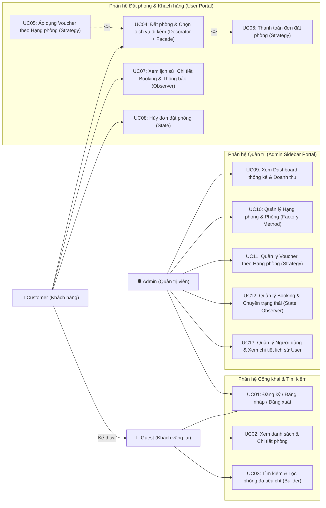

#### B. Đặc tả các Ca sử dụng cốt lõi (Core Use Cases)

1. **Đặc tả UC04: Đặt phòng trực tuyến & Chọn dịch vụ đi kèm**
   - **Tác nhân chính**: Customer (Khách hàng đã đăng nhập).
   - **Tiền điều kiện**: Tài khoản hợp lệ (không bị khóa); phòng đang ở trạng thái `AVAILABLE` và không trùng lịch.
   - **Luồng sự kiện chính**:
     1. Khách hàng chọn ngày nhận phòng (`checkInDate`), ngày trả phòng (`checkOutDate`), số khách (`guestCount`) và ghi chú.
     2. Khách hàng tích chọn các dịch vụ phụ trợ (`BREAKFAST`, `AIRPORT_PICKUP`, `EXTRA_BED`, `SPA`); giao diện gọi `/api/bookings/preview` để hiển thị bảng bóc tách chi phí trực tiếp.
     3. Khách hàng chọn/nhập mã giảm giá (`voucherCode`) và phương thức thanh toán (`E_WALLET`, `CREDIT_CARD`, `PAY_AT_HOTEL`), sau đó nhấn **"Xác nhận Đặt phòng"**.
     4. `BookingController` dùng `BookingOrder.Builder` đóng gói dữ liệu và gọi `BookingFacade.placeBooking(order)`:
        - Kiểm tra phòng trống & sức chứa (`RoomService`).
        - Bọc chi phí phòng gốc với chuỗi `BookingServiceDecorator` (**Decorator Pattern**).
        - Kiểm tra hạng phòng áp dụng và tính giảm giá qua `DiscountContextService` (**Strategy Pattern**).
        - Thực thi thanh toán qua `PaymentContextService` (**Strategy Pattern**). Nếu thanh toán trực tuyến (`PAID`), tự động kích hoạt `BookingStateResolver.applyAction(CONFIRM)` chuyển đơn sang `CONFIRMED` (**State Pattern**).
        - Lưu đơn vào MySQL và phát sự kiện `BOOKING_CREATED` qua `BookingEventPublisher` (**Observer Pattern**).
   - **Luồng ngoại lệ**: Nếu trùng lịch đặt phòng, vượt quá sức chứa hoặc mã Voucher không áp dụng cho hạng phòng đang chọn, hệ thống ném `BusinessRuleException` và hiển thị thông báo tiếng Việt rõ ràng.

2. **Đặc tả UC12: Quản lý Booking & Chuyển đổi trạng thái (Admin & User)**
   - **Tác nhân**: Administrator (hoặc Customer khi yêu cầu hủy đơn).
   - **Luồng sự kiện chính**:
     1. Người dùng gửi yêu cầu chuyển trạng thái (`CONFIRM`, `CHECK_IN`, `CHECK_OUT`, `CANCEL`).
     2. `BookingFacade.transitionBookingState()` ủy quyền cho `BookingStateResolver` lấy đối tượng `BookingState` ứng với trạng thái hiện tại của đơn:
        - `PendingState`: Cho phép `confirm()` hoặc `cancel()`. Chặn `checkIn()` và `checkOut()`.
        - `ConfirmedState`: Cho phép `checkIn()` (đồng thời tự động cập nhật `PaymentStatus = PAID` nếu khách trả tại quầy) hoặc `cancel()`.
        - `CheckedInState`: Chỉ cho phép `checkOut()`. Tuyệt đối chặn `cancel()`.
        - `CheckedOutState` / `CancelledState`: Trạng thái kết thúc, từ chối mọi thao tác.
     3. Nếu hành động là `CANCEL` hợp lệ, hệ thống phát thông báo `BOOKING_CANCELLED` qua **Observer Pattern** và xóa đơn đã hủy khỏi danh sách đặt phòng đang hoạt động để giải phóng lịch phòng ngay lập tức.

---

## CHƯƠNG II: CƠ SỞ LÝ THUYẾT SOLID, KIẾN TRÚC MVC & THIẾT KẾ CSDL (ERD)

### 2.1. Tổng quan lý thuyết 3 nhóm Design Patterns (GoF)

1. **Nhóm Khởi tạo (Creational Patterns)**:
   - **Bản chất**: Cung cấp các cơ chế khởi tạo đối tượng linh hoạt, che giấu logic khởi tạo phức tạp và tách rời quá trình tạo lập đối tượng khỏi lớp sử dụng nó (*Client*).
   - **Ý nghĩa**: Giúp hệ thống không bị phụ thuộc cứng vào toán tử `new` và các Constructor cồng kềnh, dễ dàng mở rộng dòng sản phẩm mới.
2. **Nhóm Cấu trúc (Structural Patterns)**:
   - **Bản chất**: Tập trung vào cách kết hợp các lớp và các đối tượng để hình thành các cấu trúc lớn hơn, đồng thời giữ cho cấu trúc đó mềm dẻo, hiệu quả và che giấu sự phức tạp nội tại của các hệ thống con.
   - **Ý nghĩa**: Cho phép mở rộng tính năng của đối tượng lúc runtime mà không làm bùng nổ cây kế thừa, đồng thời giảm sự phụ thuộc giữa tầng giao tiếp (*Controller*) và tầng nghiệp vụ (*Subsystems*).
3. **Nhóm Hành vi (Behavioral Patterns)**:
   - **Bản chất**: Giải quyết bài toán phân chia trách nhiệm, đóng gói các thuật toán, quản lý trạng thái và cơ chế giao tiếp giữa các đối tượng trong thời gian chạy (*Runtime*).
   - **Ý nghĩa**: Loại bỏ các cấu trúc điều kiện `if-else` / `switch-case` phức tạp, cho phép thay đổi thuật toán và hành vi của đối tượng một cách linh hoạt.

---

### 2.2. Phân tích chi tiết cách áp dụng 5 nguyên lý SOLID trong Hệ thống Đặt phòng Khách sạn

#### 1. Nguyên lý S — Single Responsibility Principle (Nguyên lý Đơn trách nhiệm)
- **Phát biểu lý thuyết**: *"Một lớp (class) chỉ nên nắm giữ một trách nhiệm duy nhất và chỉ có duy nhất một lý do để thay đổi."*
- **Vấn đề nếu không áp dụng**: Nếu gom toàn bộ nghiệp vụ vào một lớp `BookingService` duy nhất (vừa kiểm tra lịch trống của phòng, vừa cộng tiền dịch vụ phụ trợ, vừa kiểm tra hạn sử dụng Voucher, vừa xử lý thanh toán, vừa gửi thông báo cho khách), lớp này sẽ dài hàng nghìn dòng code. Khi thay đổi công thức tính giá Buffet sáng hoặc thay đổi cấu trúc thông báo, ta đều phải sửa cùng một lớp `BookingService`, dễ gây lỗi dây chuyền (*Regression Bug*).
- **Cách áp dụng trong dự án**: Hệ thống phân tách rõ ràng trách nhiệm cho từng lớp chuyên biệt:
  - `RoomService`: Chỉ chịu trách nhiệm quản lý danh mục phòng, hạng phòng và kiểm tra xung đột lịch đặt phòng (`validateRoomForBooking`).
  - `BookingCostBuilderService` & các lớp `BookingServiceDecorator`: Chỉ chịu trách nhiệm tính toán chi phí phòng gốc và các dịch vụ đi kèm.
  - `DiscountContextService` & các lớp `DiscountStrategy`: Chỉ chịu trách nhiệm kiểm tra tính hợp lệ của Voucher (hạn dùng, giá trị đơn tối thiểu, hạng phòng áp dụng) và tính số tiền giảm giá.
  - `PaymentContextService` & các lớp `PaymentStrategy`: Chỉ chịu trách nhiệm xử lý giao dịch thanh toán và sinh mã tham chiếu giao dịch.
  - `BookingStateResolver` & các lớp `BookingState`: Chỉ chịu trách nhiệm kiểm soát quy tắc chuyển đổi trạng thái của đơn đặt phòng.
  - `InAppNotificationObserver`, `EmailNotificationObserver`, `AuditLogObserver`: Mỗi lớp chỉ chịu trách nhiệm cho đúng một kênh thông báo/ghi nhật ký.

#### 2. Nguyên lý O — Open/Closed Principle (Nguyên lý Đóng/Mở)
- **Phát biểu lý thuyết**: *"Các thực thể phần mềm (lớp, module, hàm) nên MỞ cho việc mở rộng (Open for extension), nhưng ĐÓNG cho việc sửa đổi (Closed for modification)."*
- **Cách áp dụng trong dự án**:
  - **Trong tính năng Giảm giá & Thanh toán (Strategy Pattern)**: `DiscountContextService` và `PaymentContextService` sử dụng cơ chế *Dependency Injection* của Spring để tự động thu thập danh sách `List<DiscountStrategy>` và `List<PaymentStrategy>` vào một `Map` ngay khi khởi động:
    ```java
    public DiscountContextService(List<DiscountStrategy> strategies, VoucherRepository voucherRepository) {
        this.strategyMap = strategies.stream()
                .collect(Collectors.toMap(DiscountStrategy::getDiscountType, Function.identity()));
        this.voucherRepository = voucherRepository;
    }
    ```
    Khi khách sạn muốn bổ sung thêm một loại khuyến mãi mới (ví dụ: `MemberTierDiscountStrategy`) hoặc cổng thanh toán mới (`PayPalPaymentStrategy`), lập trình viên chỉ cần **tạo thêm 1 class mới** thực thi interface tương ứng mà **không cần sửa đổi bất kỳ dòng code nào** trong `DiscountContextService`, `PaymentContextService` hay `BookingFacade`.
  - **Trong tính năng Thông báo (Observer Pattern)**: Khi muốn thêm kênh gửi tin nhắn Zalo/Telegram cho khách hàng, chỉ cần tạo lớp `ZaloNotificationObserver implements BookingObserver` gắn `@Component`, `BookingEventPublisher` sẽ tự động phát sự kiện tới kênh mới mà không cần sửa code của lớp phát sự kiện.

#### 3. Nguyên lý L — Liskov Substitution Principle (Nguyên lý Thay thế Liskov)
- **Phát biểu lý thuyết**: *"Các đối tượng của lớp con (Subtype) có thể thay thế cho các đối tượng của lớp cha/interface (Supertype) mà không làm thay đổi tính đúng đắn của chương trình."*
- **Cách áp dụng trong dự án**:
  - **Trong Decorator Pattern (`BookingCostComponent`)**: Cả đối tượng gốc `BaseRoomBookingCost` và tất cả các lớp bọc dịch vụ (`BreakfastDecorator`, `AirportPickupDecorator`, `ExtraBedDecorator`, `SpaDecorator`) đều thực thi giao diện `BookingCostComponent`. Đối tượng bên ngoài (`BookingCostBuilderService`) chỉ làm việc với kiểu trừu tượng `BookingCostComponent` và có thể bọc lồng nhau theo bất kỳ thứ tự nào mà hàm `calculateCost()` và `getDescription()` vẫn luôn trả về kết quả chính xác, không bao giờ xảy ra hiện tượng ép kiểu (`instanceof`) hay ném ngoại lệ bất ngờ.
  - **Trong Strategy Pattern**: Mọi lớp thực thi `DiscountStrategy` đều đảm bảo hậu điều kiện (post-condition): số tiền giảm trả về luôn nằm trong đoạn `[0, subTotal]` (nhờ `.min(subTotal)`), đảm bảo tổng tiền thanh toán cuối cùng không bao giờ bị âm dù thay thế bất kỳ chiến lược giảm giá nào.

#### 4. Nguyên lý I — Interface Segregation Principle (Nguyên lý Phân tách Interface)
- **Phát biểu lý thuyết**: *"Không nên ép các lớp Client phải phụ thuộc vào các phương thức mà chúng không sử dụng. Nhiều interface nhỏ, chuyên biệt sẽ tốt hơn một interface lớn đa năng."*
- **Cách áp dụng trong dự án**:
  - Thay vì tạo một interface `HotelBusinessOperations` chứa hàng chục phương thức hỗn tạp, hệ thống chia thành các interface nhỏ gọn, đơn mục đích:
    - `RoomTemplate`: Chỉ định nghĩa cấu hình mẫu của một hạng phòng.
    - `BookingCostComponent`: Chỉ gồm 2 phương thức `calculateCost()` và `getDescription()`.
    - `DiscountStrategy`: Chỉ gồm `getDiscountType()` và `calculateDiscount(...)`.
    - `PaymentStrategy`: Chỉ gồm `getPaymentMethod()` và `processPayment(Booking)`.
    - `BookingState`: Chỉ gồm các hành vi chuyển trạng thái `confirm()`, `checkIn()`, `checkOut()`, `cancel()`.
    - `BookingObserver`: Chỉ gồm duy nhất phương thức `onBookingEvent(BookingEvent)`.

#### 5. Nguyên lý D — Dependency Inversion Principle (Nguyên lý Đảo ngược Phụ thuộc)
- **Phát biểu lý thuyết**: *"1. Các module cấp cao không nên phụ thuộc vào các module cấp thấp. Cả hai nên phụ thuộc vào Abstraction (trừu tượng). 2. Abstraction không nên phụ thuộc vào chi tiết; chi tiết nên phụ thuộc vào Abstraction."*
- **Cách áp dụng trong dự án**:
  - Module điều phối cấp cao là `BookingFacade` và các `RestController` hoàn toàn không phụ thuộc trực tiếp vào các lớp cài đặt cụ thể cấp thấp (như `CreditCardPaymentStrategy`, `PercentageDiscountStrategy`, `InAppNotificationObserver` hay các câu lệnh SQL cụ thể), mà chỉ phụ thuộc vào các interface trừu tượng và các Spring Data JPA Repository interfaces (`RoomRepository`, `BookingRepository`, `VoucherRepository`).

---

### 2.3. Thiết kế Kiến trúc Tổng thể Phần mềm (MVC Tách rời) & Mô hình CSDL (ERD 10 Bảng)

#### A. Sơ đồ Kiến trúc Tổng thể MVC
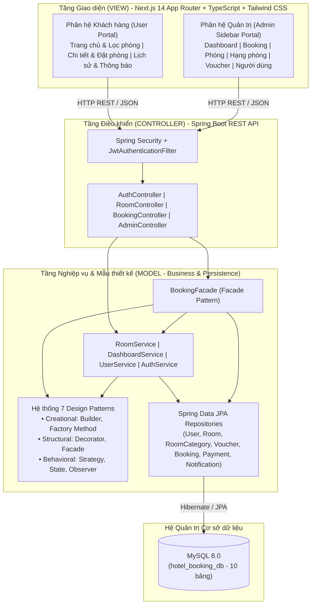

#### B. Sơ đồ Thực thể Kết hợp (ERD - 10 Bảng trong MySQL)
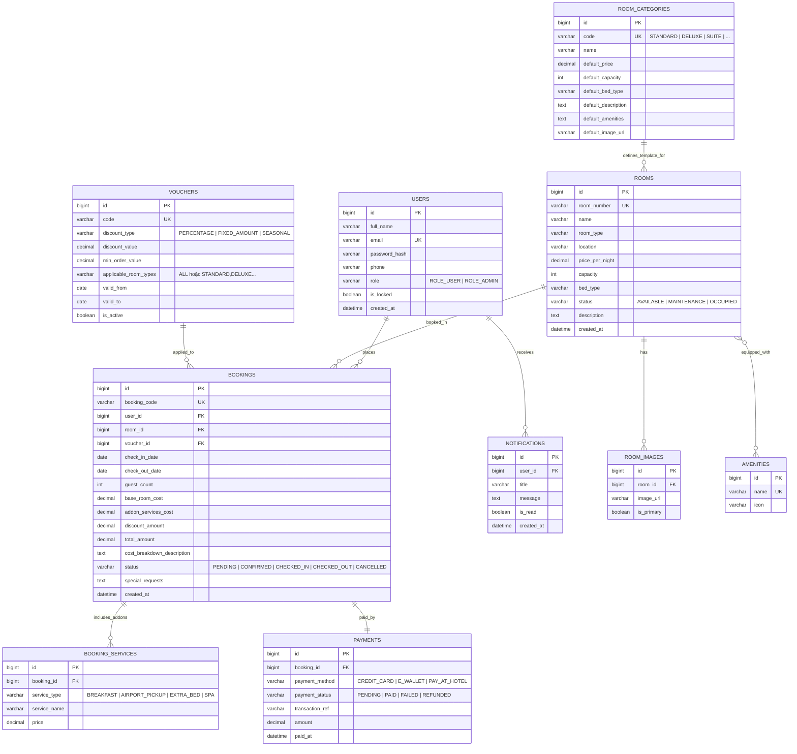

---

## CHƯƠNG III: PHÂN TÍCH VÀ THIẾT KẾ CHI TIẾT 07 DESIGN PATTERNS THUỘC 3 NHÓM

### 3.1. Bảng ánh xạ 7 Design Patterns vào các Tính năng Nghiệp vụ

| Nhóm Pattern | Tên Mẫu thiết kế | Các lớp (Classes) cài đặt trong Source Code | Tính năng Nghiệp vụ áp dụng trong Hệ thống |
| :--- | :--- | :--- | :--- |
| **1. Creational**<br>*(Khởi tạo)* | **1. Builder Pattern** | `RoomSearchCriteria`<br>`RoomSearchCriteria.Builder`<br>`BookingOrder`<br>`BookingOrder.Builder` | • **Tìm kiếm & Lọc phòng đa tiêu chí** (User & Admin): Tìm theo tên, địa điểm, hạng phòng, số khách, khoảng giá (`minPrice` - `maxPrice`), ngày nhận/trả.<br>• **Đặt phòng trực tuyến**: Khởi tạo đối tượng đơn đặt phòng từng bước và kiểm tra ràng buộc ngày ở, số khách. |
| **1. Creational**<br>*(Khởi tạo)* | **2. Factory Method Pattern** | `RoomTemplate` *(Interface)*<br>`StandardRoomTemplate`<br>`DeluxeRoomTemplate`<br>`SuiteRoomTemplate`<br>`RoomFactory`<br>`RoomCategory` | • **Quản lý Phòng & Hạng phòng (Admin thêm phòng mới)**: Khi Admin chọn Hạng phòng (`STANDARD`, `DELUXE`, `SUITE` hoặc hạng phòng mới tạo), `RoomFactory` tự động khởi tạo phòng với giá sàn, sức chứa, loại giường, tiện nghi và hình ảnh chuẩn của hạng phòng đó. |
| **2. Structural**<br>*(Cấu trúc)* | **3. Decorator Pattern** | `BookingCostComponent`<br>`BaseRoomBookingCost`<br>`BookingServiceDecorator`<br>`BreakfastDecorator`<br>`AirportPickupDecorator`<br>`ExtraBedDecorator`<br>`SpaDecorator`<br>`BookingCostBuilderService` | • **Chọn dịch vụ đi kèm & Báo giá trực tiếp khi đặt phòng (User)**: Cho phép khách hàng tích chọn linh hoạt các dịch vụ phụ trợ (*Buffet sáng, Xe đưa đón sân bay, Giường phụ, Spa*), tự động bọc và cộng dồn chi phí cũng như xuất mô tả chi tiết hóa đơn. |
| **2. Structural**<br>*(Cấu trúc)* | **4. Facade Pattern** | `BookingFacade` | • **Đặt phòng trọn gói, Xem trước báo giá & Quản lý trạng thái Booking**: Cung cấp một điểm giao tiếp duy nhất cho `BookingController` và `AdminController`, điều phối 6 hệ thống con bên dưới (Kiểm tra phòng $\rightarrow$ Decorator tính giá $\rightarrow$ Strategy giảm giá $\rightarrow$ Strategy thanh toán $\rightarrow$ State chuyển trạng thái $\rightarrow$ Observer thông báo). |
| **3. Behavioral**<br>*(Hành vi)* | **5. Strategy Pattern** | • *Giảm giá*: `DiscountStrategy`, `PercentageDiscountStrategy`, `FixedAmountDiscountStrategy`, `SeasonalDiscountStrategy`, `DiscountContextService`<br>• *Thanh toán*: `PaymentStrategy`, `CreditCardPaymentStrategy`, `EWalletPaymentStrategy`, `PayAtHotelPaymentStrategy`, `PaymentContextService` | • **Quản lý & Áp dụng Voucher theo Hạng phòng**: Kiểm tra điều kiện Hạng phòng (`ALL` hoặc hạng phòng cụ thể) và áp dụng chiến lược tính giảm giá theo %, tiền cố định hoặc mùa lễ.<br>• **Thanh toán đơn đặt phòng**: Xử lý thanh toán linh hoạt qua Thẻ tín dụng, Ví điện tử VNPay/MoMo hoặc Thanh toán tại khách sạn. |
| **3. Behavioral**<br>*(Hành vi)* | **6. State Pattern** | `BookingState` *(Interface)*<br>`PendingState`<br>`ConfirmedState`<br>`CheckedInState`<br>`CheckedOutState`<br>`CancelledState`<br>`BookingStateResolver` | • **Quản lý vòng đời trạng thái đơn đặt phòng (Admin & User)**: Kiểm soát chặt chẽ các hành động `CONFIRM` (Duyệt đơn), `CHECK_IN` (Nhận phòng), `CHECK_OUT` (Trả phòng), `CANCEL` (Hủy & xóa đơn khỏi danh sách hoạt động). Ngăn chặn mọi thao tác nhảy cóc hoặc hủy đơn khi khách đã Check-in. |
| **3. Behavioral**<br>*(Hành vi)* | **7. Observer Pattern** | `BookingObserver` *(Interface)*<br>`InAppNotificationObserver`<br>`EmailNotificationObserver`<br>`AuditLogObserver`<br>`BookingEventPublisher`<br>`BookingEvent` | • **Thông báo tự động thời gian thực (User & Admin)**: Khi khách đặt phòng mới, hủy phòng hoặc khi Admin cập nhật trạng thái đơn/thanh toán, hệ thống tự động tạo thông báo trên giao diện khách hàng (*In-App*), gửi Email mô phỏng và ghi nhật ký kiểm toán (*Audit Log*). |

---

### 3.2. Sơ đồ Luồng xử lý (Workflow) của từng Nhóm Design Patterns

#### A. Sơ đồ Luồng xử lý của Nhóm 1: Creational Patterns (Builder & Factory Method)
```mermaid
flowchart TB
    subgraph Flow_Builder["1. Luồng xử lý Builder Pattern (Tìm kiếm phòng & Đặt phòng)"]
        B_Start["Người dùng nhập thông tin trên Giao diện\n(Bộ lọc tìm kiếm HOẶC Form Đặt phòng)"] --> B_Init["Controller khởi tạo Builder\nRoomSearchCriteria.builder() / BookingOrder.builder()"]
        B_Init --> B_Chain["Gán chuỗi thuộc tính tùy chọn (Fluent API)\n.roomId().dates(in, out).guestCount()\n.addonServices().voucherCode().paymentMethod()"]
        B_Chain --> B_Build["Gọi phương thức .build()"]
        B_Build --> B_Val{"Kiểm tra ràng buộc\ntrong validate()"}
        B_Val -->|"Vi phạm (checkOut <= checkIn\nhoặc guestCount <= 0)"| B_Err["Ném BusinessRuleException\nBáo lỗi rõ ràng cho Client"]
        B_Val -->|"Hợp lệ"| B_Done["Trả về đối tượng bất biến (Immutable)\nBookingOrder / RoomSearchCriteria"]
    end

    subgraph Flow_Factory["2. Luồng xử lý Factory Method Pattern (Admin Thêm phòng mới)"]
        F_Start["Admin vào Quản lý Phòng\nNhấn '+ Thêm Phòng mới' & chọn Hạng phòng"] --> F_Call["RoomService gọi\nRoomFactory.createRoom(...)"]
        F_Call --> F_Lookup["RoomFactory tra cứu cấu hình từ\nRoomCategory (DB) & RoomTemplate (Map)"]
        F_Lookup --> F_Apply["Tự động áp dụng Giá mặc định, Sức chứa,\nLoại giường, Tiện nghi & Ảnh của Hạng phòng"]
        F_Apply --> F_Custom["Ghi đè các thông số tùy chỉnh (nếu Admin nhập riêng)\nvà lưu Room vào MySQL"]
    end
```

#### B. Sơ đồ Luồng xử lý của Nhóm 2: Structural Patterns (Facade & Decorator)
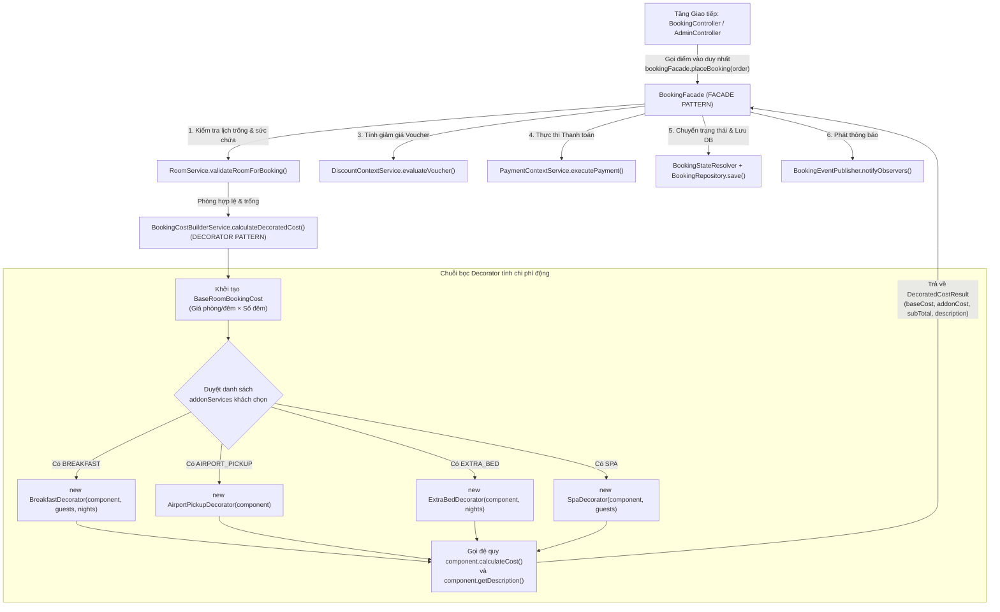

#### C. Sơ đồ Luồng xử lý của Nhóm 3: Behavioral Patterns (Strategy, State & Observer)
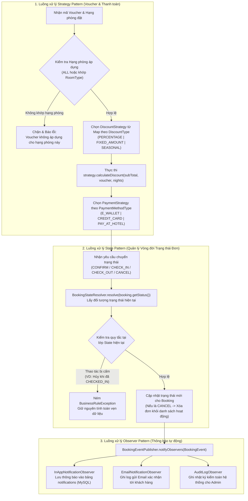

---

### 3.3. Mẫu 1 (Nhóm Creational): Builder Pattern

#### A. Lý do lựa chọn & Bài toán thực tế
Trong hệ thống đặt phòng khách sạn, hai đối tượng `RoomSearchCriteria` (tiêu chí tìm kiếm/lọc phòng) và `BookingOrder` (yêu cầu đặt phòng) có tới 8–9 thuộc tính, trong đó có nhiều thuộc tính tùy chọn (như `voucherCode`, `addonServices`, `specialRequests`, `minPrice`, `maxPrice`).
- Nếu sử dụng Constructor nhiều tham số (*Telescoping Constructor*), thứ tự các tham số cùng kiểu (`LocalDate checkIn`, `LocalDate checkOut` hoặc `BigDecimal minPrice`, `BigDecimal maxPrice`) rất dễ bị truyền nhầm.
- Nếu sử dụng JavaBeans (`new BookingOrder()` rồi gọi `set...`), đối tượng có thể rơi vào trạng thái không nhất quán (ví dụ: quên gán `roomId` hoặc truyền `checkOutDate` trước `checkInDate`) trước khi được đưa vào xử lý.
- **Giải pháp**: Áp dụng **Builder Pattern** giúp khởi tạo đối tượng từng bước qua chuỗi phương thức trực quan (*Fluent Interface*), đồng thời tập trung toàn bộ logic kiểm tra tính hợp lệ (`validate()`) tại phương thức `.build()`.

#### B. Vai trò các lớp và Quan hệ giữa chúng
- `BookingOrder` / `RoomSearchCriteria` (**Product**): Đối tượng phức tạp cần khởi tạo, có các thuộc tính là `final` (bất biến - *immutable*), constructor để ở phạm vi `private` để bắt buộc khởi tạo thông qua `Builder`.
- `BookingOrder.Builder` / `RoomSearchCriteria.Builder` (**Concrete Builder**): Lớp tĩnh bên trong (*Static Inner Class*) giữ các trường tạm thời, cung cấp các phương thức thiết lập trả về chính `Builder` (`this`), phương thức `validate()` kiểm tra quy tắc nghiệp vụ và phương thức `build()` trả về thực thể `Product` hoàn chỉnh.
- `BookingController` / `RoomController` (**Client / Director**): Điều khiển quá trình gọi các bước của `Builder` từ dữ liệu HTTP Request.

#### C. Sơ đồ Lớp UML (Class Diagram)
```mermaid
classDiagram
    class BookingOrder {
        -final Long userId
        -final Long roomId
        -final LocalDate checkInDate
        -final LocalDate checkOutDate
        -final Integer guestCount
        -final String voucherCode
        -final List~AddonServiceType~ addonServices
        -final PaymentMethodType paymentMethod
        -final String specialRequests
        -BookingOrder(Builder builder)
        +getStayNights() long
        +builder()$ Builder
    }

    class BookingOrder_Builder {
        -Long userId
        -Long roomId
        -LocalDate checkInDate
        -LocalDate checkOutDate
        -Integer guestCount
        -String voucherCode
        -List~AddonServiceType~ addonServices
        -PaymentMethodType paymentMethod
        -String specialRequests
        +userId(Long) Builder
        +roomId(Long) Builder
        +dates(LocalDate, LocalDate) Builder
        +guestCount(Integer) Builder
        +voucherCode(String) Builder
        +addonServices(List~AddonServiceType~) Builder
        +addService(AddonServiceType) Builder
        +paymentMethod(PaymentMethodType) Builder
        +specialRequests(String) Builder
        -validate() void
        +build() BookingOrder
    }

    class RoomSearchCriteria {
        -final String keyword
        -final String location
        -final String roomType
        -final Integer minGuests
        -final BigDecimal minPrice
        -final BigDecimal maxPrice
        -final LocalDate checkInDate
        -final LocalDate checkOutDate
        -final RoomStatus status
        +builder()$ Builder
    }

    class BookingController {
        +createBooking(UserDetails, CreateBookingRequest) ResponseEntity
        +previewBookingPrice(PreviewBookingRequest) ResponseEntity
    }

    BookingController ..> BookingOrder_Builder : "khởi tạo & cấu hình"
    BookingOrder_Builder ..> BookingOrder : "tạo ra (creates)"
    BookingOrder +-- BookingOrder_Builder : "inner class"
```

#### D. Sơ đồ Tuần tự UML (Sequence Diagram)
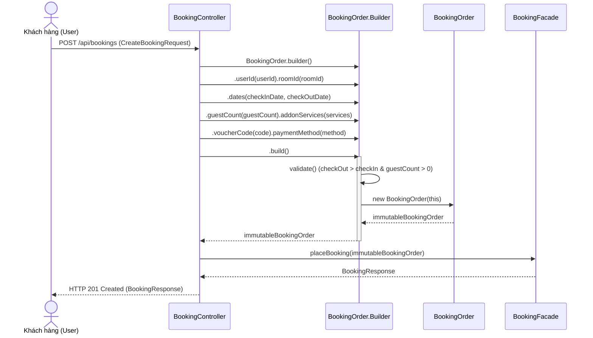

---

### 3.4. Mẫu 2 (Nhóm Creational): Factory Method Pattern

#### A. Lý do lựa chọn & Bài toán thực tế
Khi Quản trị viên thêm phòng mới vào khách sạn (thuộc các hạng `STANDARD`, `DELUXE`, `SUITE` hoặc các hạng phòng mở rộng do Admin định nghĩa trong mục *Quản lý Hạng phòng*), mỗi hạng phòng có bộ thông số tiêu chuẩn riêng (giá sàn mặc định, sức chứa tối đa, loại giường, danh sách tiện nghi đi kèm và hình ảnh đại diện).
- Nếu đặt câu lệnh `if (type.equals("STANDARD")) { ... } else if (type.equals("DELUXE")) { ... }` trực tiếp trong `RoomService`, mỗi khi thay đổi tiêu chuẩn phòng hoặc thêm hạng phòng mới, ta phải sửa code của `RoomService`.
- **Giải pháp**: Áp dụng **Factory Method Pattern** thông qua giao diện `RoomTemplate` và lớp `RoomFactory` kết hợp với bảng `RoomCategory` để đóng gói hoàn toàn quy trình sản xuất đối tượng `Room` theo hạng phòng.

#### B. Vai trò các lớp và Quan hệ giữa chúng
- `RoomTemplate` (**Product Interface**): Định nghĩa khuôn mẫu cấu hình chuẩn cho một hạng phòng (`getRoomType()`, `getDefaultCapacity()`, `getDefaultBedType()`, `getDefaultBasePrice()`, `getDefaultAmenities()`, `getDefaultImages()`).
- `StandardRoomTemplate`, `DeluxeRoomTemplate`, `SuiteRoomTemplate` (**Concrete Products / Templates**): Cài đặt thông số chuẩn cho 3 hạng phòng cốt lõi.
- `RoomCategory` (**Dynamic Category Metadata**): Thực thể lưu trữ cấu hình hạng phòng động do Admin thêm/sửa trên giao diện.
- `RoomFactory` (**Creator / Factory**): Cung cấp phương thức nhà máy `createRoom(...)` tra cứu cấu hình từ `RoomCategoryRepository` và `Map<String, RoomTemplate>` để khởi tạo thực thể `Room` hoàn chỉnh kèm danh sách `RoomImage` và `Amenity`.

#### C. Sơ đồ Lớp UML (Class Diagram)
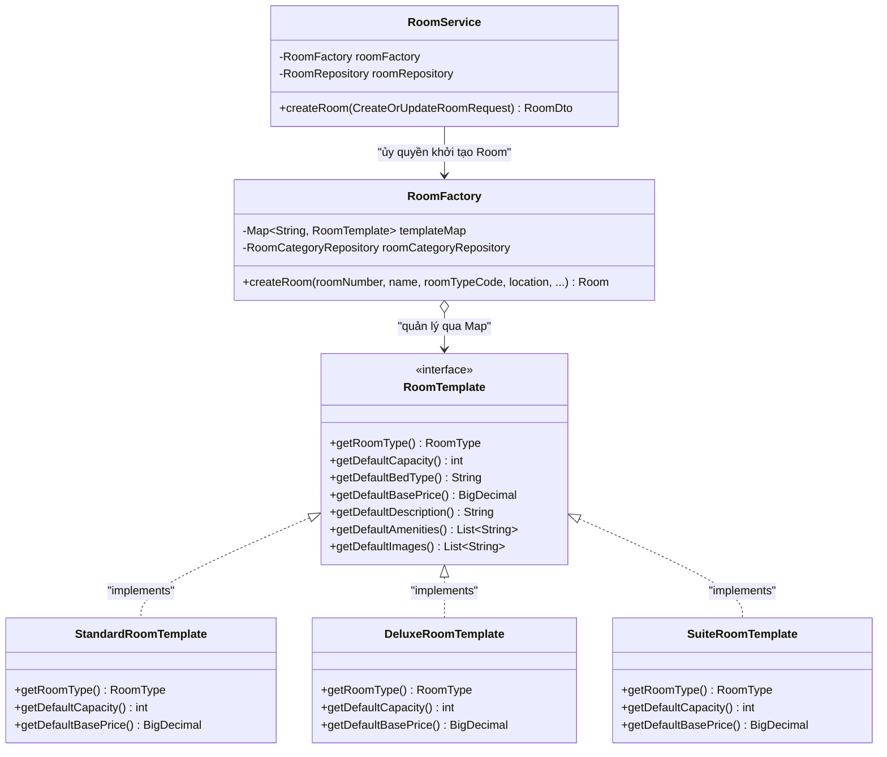

#### D. Sơ đồ Tuần tự UML (Sequence Diagram)
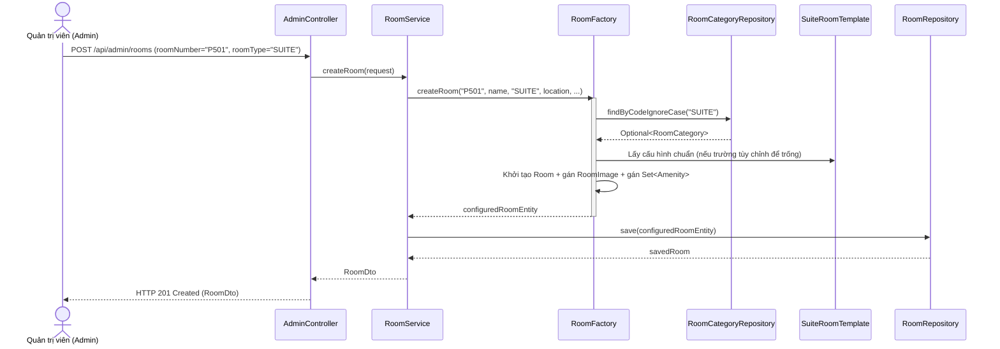

---

### 3.5. Mẫu 3 (Nhóm Structural): Decorator Pattern

#### A. Lý do lựa chọn & Bài toán thực tế
Khi khách hàng đặt phòng, ngoài tiền thuê phòng cơ bản (`giá phòng/đêm × số đêm`), khách hàng có thể chọn thêm bất kỳ tổ hợp dịch vụ phụ trợ nào:
- **Buffet sáng (`BREAKFAST`)**: `150.000 VNĐ × số khách × số đêm`.
- **Xe riêng đưa đón sân bay (`AIRPORT_PICKUP`)**: `350.000 VNĐ` (phí cố định).
- **Giường phụ (`EXTRA_BED`)**: `300.000 VNĐ × số đêm`.
- **Gói thư giãn Spa & Sauna (`SPA`)**: `400.000 VNĐ × số khách`.

Nếu dùng kế thừa tĩnh (tạo các lớp `RoomWithBreakfast`, `RoomWithBreakfastAndSpa`, `RoomWithAllServices`...), với 4 dịch vụ sẽ phát sinh $2^4 = 16$ lớp con (bùng nổ tổ hợp lớp - *Class Explosion*).
- **Giải pháp**: Áp dụng **Decorator Pattern** để bọc (wrap) đối tượng tiền phòng cơ bản bằng các lớp dịch vụ đi kèm một cách linh hoạt lúc runtime.

#### B. Vai trò các lớp và Quan hệ giữa chúng
- `BookingCostComponent` (**Component Interface**): Khai báo giao diện chung gồm `calculateCost()` và `getDescription()`.
- `BaseRoomBookingCost` (**Concrete Component**): Lớp gốc tính tiền phòng cơ bản (`pricePerNight * nights`).
- `BookingServiceDecorator` (**Abstract Decorator**): Lớp trừu tượng vừa thực thi `BookingCostComponent` vừa chứa một tham chiếu `protected final BookingCostComponent wrapped` (quan hệ *Aggregation + Inheritance*). Phương thức `calculateCost()` lấy `wrapped.calculateCost().add(getServiceCost())`.
- `BreakfastDecorator`, `AirportPickupDecorator`, `ExtraBedDecorator`, `SpaDecorator` (**Concrete Decorators**): Các lớp bọc cụ thể định nghĩa chi phí và tên hiển thị của từng dịch vụ.
- `BookingCostBuilderService` (**Client组装**): Duyệt danh sách dịch vụ khách chọn và bọc liên tiếp các Decorator quanh `BaseRoomBookingCost`.

#### C. Sơ đồ Lớp UML (Class Diagram)
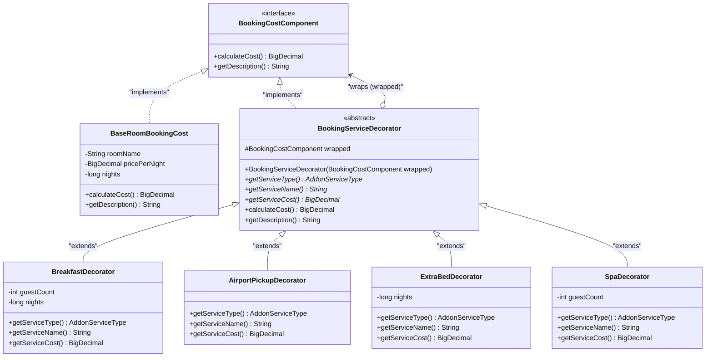

#### D. Sơ đồ Tuần tự UML (Sequence Diagram)
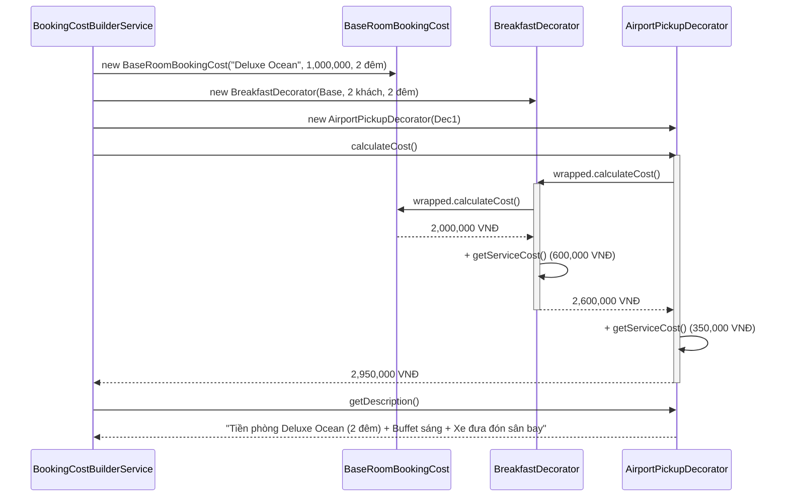

---

### 3.6. Mẫu 4 (Nhóm Structural): Facade Pattern

#### A. Lý do lựa chọn & Bài toán thực tế
Để hoàn tất một giao dịch đặt phòng trực tuyến, hệ thống phải thực hiện tuần tự 6 bước trên nhiều dịch vụ khác nhau:
1. Kiểm tra trạng thái phòng, sức chứa và kiểm tra xung đột lịch đặt phòng (`RoomService`).
2. Tính tiền phòng gốc và bọc các dịch vụ đi kèm (`BookingCostBuilderService`).
3. Kiểm tra điều kiện mã giảm giá theo Hạng phòng và tính số tiền giảm (`DiscountContextService`).
4. Khởi tạo thực thể `Booking` kèm danh sách `BookingServiceItem`.
5. Thực thi chiến lược thanh toán (`PaymentContextService`) và tự động chuyển trạng thái qua `BookingStateResolver` nếu thanh toán trực tuyến hoàn tất.
6. Lưu vào CSDL (`BookingRepository`) và phát sự kiện thông báo tới các kênh (`BookingEventPublisher`).

Nếu để `BookingController` trực tiếp phụ thuộc và gọi cả 6 dịch vụ này, tầng Controller sẽ bị phình to, vi phạm nguyên lý **SRP** và gây khó khăn khi cần tái sử dụng quy trình đặt phòng hoặc chuyển trạng thái từ `AdminController`.
- **Giải pháp**: Áp dụng **Facade Pattern** bằng việc xây dựng lớp `BookingFacade` làm mặt tiền giao tiếp thống nhất.

#### B. Vai trò các lớp và Quan hệ giữa chúng
- `BookingFacade` (**Facade**): Nắm giữ tham chiếu tới các Subsystem (`RoomService`, `BookingCostBuilderService`, `DiscountContextService`, `PaymentContextService`, `BookingStateResolver`, `BookingRepository`, `BookingEventPublisher`) và cung cấp các phương thức bậc cao đơn giản: `previewBookingPrice()`, `placeBooking()`, `transitionBookingState()`, `updatePaymentStatus()`.
- `BookingController` & `AdminController` (**Clients**): Chỉ cần gọi duy nhất `BookingFacade` mà không cần biết chi tiết bên trong các hệ thống con.

#### C. Sơ đồ Lớp UML (Class Diagram)
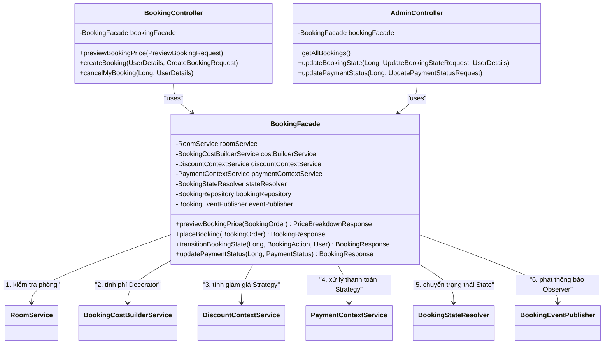

#### D. Sơ đồ Tuần tự UML (Sequence Diagram)
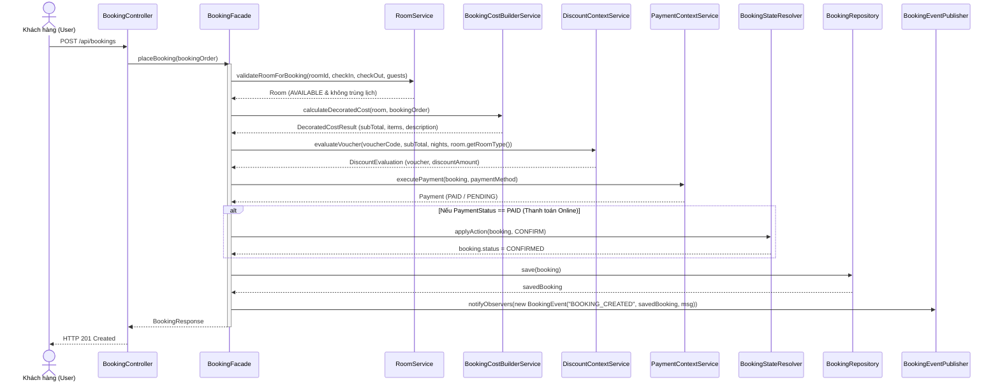

---

### 3.7. Mẫu 5 (Nhóm Behavioral): Strategy Pattern

#### A. Lý do lựa chọn & Bài toán thực tế
Trong hệ thống có hai bài toán có nhiều thuật toán biến thiên:
1. **Tính tiền giảm giá Voucher (`DiscountStrategy`)**: Hệ thống hỗ trợ giảm theo phần trăm (`PERCENTAGE`), giảm số tiền cố định (`FIXED_AMOUNT`), và giảm theo mùa/kỳ nghỉ dài ngày (`SEASONAL` — tự động cộng thưởng thêm 5% nếu khách lưu trú từ 3 đêm trở lên), kèm điều kiện kiểm tra phạm vi Hạng phòng (`ALL` hoặc danh sách hạng phòng cụ thể).
2. **Xử lý phương thức thanh toán (`PaymentStrategy`)**: Hỗ trợ Thẻ tín dụng (`CREDIT_CARD` — thanh toán tức thời `PAID`), Ví điện tử (`E_WALLET` — thanh toán tức thời `PAID`) và Thanh toán tại quầy khách sạn (`PAY_AT_HOTEL` — trạng thái chờ thanh toán `PENDING`).

- **Giải pháp**: Áp dụng **Strategy Pattern** để tách từng thuật toán giảm giá và từng phương thức thanh toán ra các lớp chiến lược độc lập, được lựa chọn động lúc runtime qua `Map` $O(1)$.

#### B. Vai trò các lớp và Quan hệ giữa chúng
- `DiscountStrategy` & `PaymentStrategy` (**Strategy Interfaces**): Định nghĩa hợp đồng chung cho họ thuật toán giảm giá và thanh toán.
- `PercentageDiscountStrategy`, `FixedAmountDiscountStrategy`, `SeasonalDiscountStrategy` (**Concrete Discount Strategies**): Cài đặt công thức tính giảm giá cụ thể.
- `CreditCardPaymentStrategy`, `EWalletPaymentStrategy`, `PayAtHotelPaymentStrategy` (**Concrete Payment Strategies**): Cài đặt quy trình tạo giao dịch thanh toán cụ thể.
- `DiscountContextService` & `PaymentContextService` (**Contexts**): Kiểm tra điều kiện đầu vào (như hạn dùng Voucher, giá trị đơn tối thiểu, hạng phòng áp dụng) và ủy quyền thực thi cho `Strategy` tương ứng.

#### C. Sơ đồ Lớp UML (Class Diagram)
```mermaid
classDiagram
    class DiscountStrategy {
        <<interface>>
        +getDiscountType() DiscountType
        +calculateDiscount(BigDecimal subTotal, Voucher voucher, long stayNights) BigDecimal
    }

    class PercentageDiscountStrategy {
        +getDiscountType() DiscountType
        +calculateDiscount(BigDecimal, Voucher, long) BigDecimal
    }

    class FixedAmountDiscountStrategy {
        +getDiscountType() DiscountType
        +calculateDiscount(BigDecimal, Voucher, long) BigDecimal
    }

    class SeasonalDiscountStrategy {
        +getDiscountType() DiscountType
        +calculateDiscount(BigDecimal, Voucher, long) BigDecimal
    }

    class DiscountContextService {
        -Map~DiscountType, DiscountStrategy~ strategyMap
        -VoucherRepository voucherRepository
        +evaluateVoucher(String code, BigDecimal subTotal, long nights, String roomType) DiscountEvaluation
    }

    class PaymentStrategy {
        <<interface>>
        +getPaymentMethod() PaymentMethodType
        +processPayment(Booking booking) Payment
    }

    class CreditCardPaymentStrategy {
        +getPaymentMethod() PaymentMethodType
        +processPayment(Booking) Payment
    }

    class EWalletPaymentStrategy {
        +getPaymentMethod() PaymentMethodType
        +processPayment(Booking) Payment
    }

    class PayAtHotelPaymentStrategy {
        +getPaymentMethod() PaymentMethodType
        +processPayment(Booking) Payment
    }

    class PaymentContextService {
        -Map~PaymentMethodType, PaymentStrategy~ strategyMap
        +executePayment(Booking booking, PaymentMethodType methodType) Payment
    }

    DiscountStrategy <|.. PercentageDiscountStrategy : "implements"
    DiscountStrategy <|.. FixedAmountDiscountStrategy : "implements"
    DiscountStrategy <|.. SeasonalDiscountStrategy : "implements"
    DiscountContextService o--> DiscountStrategy : "chọn lúc runtime"

    PaymentStrategy <|.. CreditCardPaymentStrategy : "implements"
    PaymentStrategy <|.. EWalletPaymentStrategy : "implements"
    PaymentStrategy <|.. PayAtHotelPaymentStrategy : "implements"
    PaymentContextService o--> PaymentStrategy : "chọn lúc runtime"
```

#### D. Sơ đồ Tuần tự UML (Sequence Diagram)
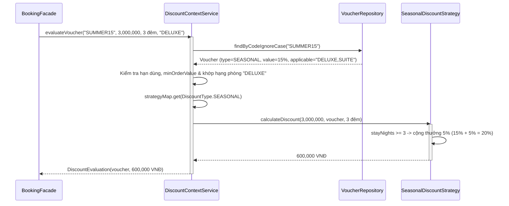

---

### 3.8. Mẫu 6 (Nhóm Behavioral): State Pattern

#### A. Lý do lựa chọn & Bài toán thực tế
Một đơn đặt phòng có vòng đời đi qua các trạng thái: `PENDING` (Chờ xác nhận) $\rightarrow$ `CONFIRMED` (Đã xác nhận) $\rightarrow$ `CHECKED_IN` (Đang lưu trú) $\rightarrow$ `CHECKED_OUT` (Đã trả phòng) hoặc `CANCELLED` (Đã hủy).
Mỗi trạng thái có các quy tắc nghiệp vụ nghiêm ngặt:
- Khi đang `PENDING`: Chỉ được phép `confirm()` hoặc `cancel()`. Không được phép `checkIn()` hay `checkOut()` ngay.
- Khi đang `CONFIRMED`: Chỉ được phép `checkIn()` (và tự động thu tiền nếu thanh toán tại quầy) hoặc `cancel()`.
- Khi đang `CHECKED_IN`: Khách đã nhận phòng và đang ở, **chỉ được phép `checkOut()`**, tuyệt đối không được phép `cancel()`.
- Khi đã `CHECKED_OUT` hoặc `CANCELLED`: Trạng thái kết thúc, từ chối mọi thay đổi tiếp theo.

Nếu không dùng **State Pattern**, lập trình viên phải viết rất nhiều câu lệnh `if-else` kiểm tra trạng thái hiện tại ở mọi hàm cập nhật.
- **Giải pháp**: Áp dụng **State Pattern**, biến mỗi trạng thái của đơn đặt phòng thành một lớp độc lập tự chịu trách nhiệm kiểm soát các bước chuyển tiếp hợp lệ của chính nó.

#### B. Vai trò các lớp và Quan hệ giữa chúng
- `BookingState` (**State Interface**): Khai báo các phương thức hành động gắn với vòng đời đơn đặt phòng (`confirm(Booking)`, `checkIn(Booking)`, `checkOut(Booking)`, `cancel(Booking)`).
- `PendingState`, `ConfirmedState`, `CheckedInState`, `CheckedOutState`, `CancelledState` (**Concrete States**): Cài đặt hành vi cụ thể cho từng trạng thái; cho phép chuyển trạng thái hợp lệ hoặc ném `BusinessRuleException` với thông báo tiếng Việt rõ ràng nếu hành động bị cấm.
- `BookingStateResolver` (**State Context / Resolver**): Ánh xạ `BookingStatus` hiện tại của thực thể `Booking` sang đối tượng `BookingState` tương ứng và ủy quyền thực thi hành động.

#### C. Sơ đồ Lớp UML (Class Diagram)
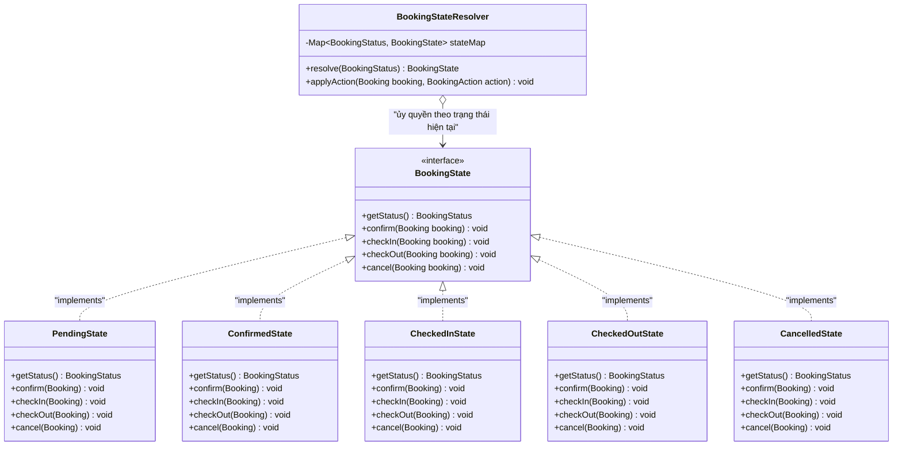

#### D. Sơ đồ Tuần tự UML (Sequence Diagram)
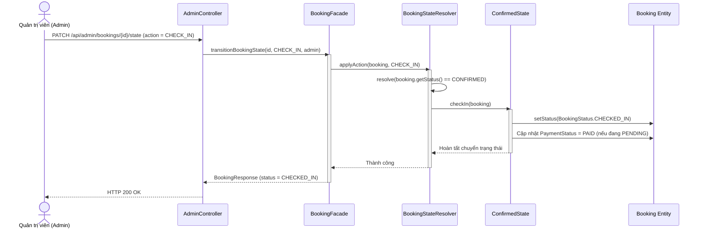

---

### 3.9. Mẫu 7 (Nhóm Behavioral): Observer Pattern

#### A. Lý do lựa chọn & Bài toán thực tế
Mỗi khi một sự kiện quan trọng xảy ra trên đơn đặt phòng (Đặt phòng mới `BOOKING_CREATED`, Chuyển trạng thái `BOOKING_STATE_CHANGED`, Hủy đơn `BOOKING_CANCELLED`, Cập nhật thanh toán `PAYMENT_STATUS_UPDATED`), hệ thống cần kích hoạt đồng thời nhiều tác vụ phụ trợ:
1. Tạo thông báo hiển thị trực tiếp trên giao diện của khách hàng (`InAppNotificationObserver` lưu vào bảng `notifications`).
2. Gửi Email xác nhận cho khách hàng (`EmailNotificationObserver`).
3. Ghi nhật ký kiểm toán (`AuditLogObserver`) phục vụ theo dõi vận hành.

Nếu gọi trực tiếp cả 3 tác vụ này bên trong `BookingFacade`, `BookingFacade` sẽ bị gắn chặt với tầng thông báo.
- **Giải pháp**: Áp dụng **Observer Pattern** với mối quan hệ *Publish–Subscribe* một-nhiều giữa `BookingEventPublisher` và danh sách `BookingObserver`.

#### B. Vai trò các lớp và Quan hệ giữa chúng
- `BookingEvent` (**Event Payload**): Đóng gói loại sự kiện (`eventType`), đối tượng `Booking` và nội dung thông điệp (`message`).
- `BookingObserver` (**Observer Interface**): Khai báo phương thức cập nhật `onBookingEvent(BookingEvent event)`.
- `InAppNotificationObserver`, `EmailNotificationObserver`, `AuditLogObserver` (**Concrete Observers**): Các lớp lắng nghe và xử lý sự kiện theo từng kênh độc lập.
- `BookingEventPublisher` (**Subject / Publisher**): Quản lý danh sách `List<BookingObserver>` và phát thông báo tới toàn bộ các Observer khi có sự kiện mới.

#### C. Sơ đồ Lớp UML (Class Diagram)
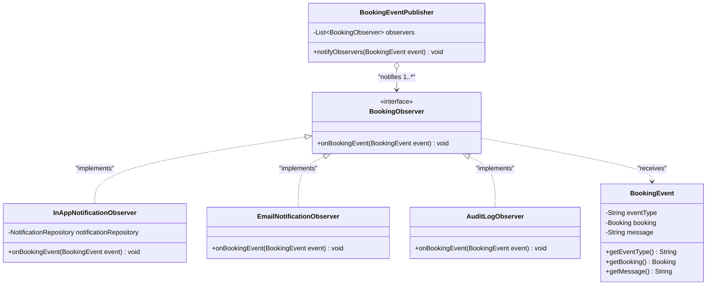

#### D. Sơ đồ Tuần tự UML (Sequence Diagram)
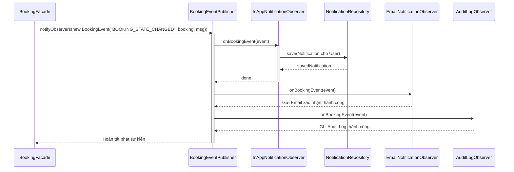

---

## CHƯƠNG IV: SO SÁNH ƯU/NHƯỢC ĐIỂM, ĐÁNH GIÁ SOLID & KỊCH BẢN KIỂM THỬ (TEST CASES / DEMO)

### 4.1. Bảng so sánh Ưu/Nhược điểm khi áp dụng Design Patterns & Đánh giá tuân thủ SOLID

| Mẫu Thiết Kế | Cách thiết kế thông thường (Không dùng Pattern) | Ưu điểm khi áp dụng Design Pattern trong Dự án | Nhược điểm / Sự đánh đổi (Trade-offs) | Nguyên lý SOLID được đảm bảo |
| :--- | :--- | :--- | :--- | :--- |
| **1. Builder Pattern** | Dùng Constructor có 8–10 tham số hoặc tạo đối tượng rỗng rồi gọi `setter` rải rác; dễ truyền nhầm thứ tự tham số và tạo ra đối tượng chưa được kiểm tra ràng buộc. | • Đọc hiểu trực quan nhờ chuỗi phương thức (*Fluent API*).<br>• Đảm bảo tính bất biến (*Immutability*) và gom toàn bộ logic kiểm tra hợp lệ (`validate()`) về một nơi duy nhất tại `.build()`. | • Cần viết thêm lớp `Builder` tĩnh bên trong lớp sản phẩm. | **SRP**: Tách trách nhiệm khởi tạo & kiểm tra hợp lệ dữ liệu đầu vào khỏi đối tượng nghiệp vụ. |
| **2. Factory Method** | Dùng `switch-case` theo mã hạng phòng ngay trong `RoomService` để gán giá, sức chứa, giường và tiện nghi mặc định. | • Đóng gói hoàn toàn cấu hình mặc định của từng hạng phòng vào các `RoomTemplate` và `RoomCategory`.<br>• Admin có thể thêm hạng phòng mới mà không cần sửa `RoomService`. | • Tăng số lượng lớp `Template` cho các hạng phòng tiêu chuẩn. | **OCP & SRP**: Mở rộng hạng phòng mới dễ dàng mà không sửa đổi logic của `RoomService`. |
| **3. Decorator Pattern** | Dùng nhiều câu lệnh `if (hasBreakfast) total += ...` hoặc tạo hàng chục lớp con kế thừa cho từng tổ hợp dịch vụ đi kèm. | • Kết hợp động bất kỳ tổ hợp dịch vụ đi kèm nào lúc runtime.<br>• Tự động tổng hợp cả tổng chi phí (`calculateCost()`) lẫn chuỗi mô tả chi tiết hóa đơn (`getDescription()`). | • Tạo ra nhiều đối tượng nhỏ bọc lồng nhau trong bộ nhớ khi tính toán. | **OCP & LSP**: Thêm dịch vụ mới (ví dụ: *LaundryDecorator*) chỉ cần thêm 1 lớp con, không sửa lớp gốc. |
| **4. Facade Pattern** | `BookingController` và `AdminController` phải inject và gọi trực tiếp 6–7 Services/Repositories khác nhau, gây lặp code và phụ thuộc chặt. | • Cung cấp một điểm giao tiếp duy nhất (`BookingFacade`), che giấu toàn bộ sự phức tạp của 6 hệ thống con.<br>• Giảm thiểu sự phụ thuộc giữa tầng `Controller` và tầng `Model/Service`. | • Lớp `Facade` điều phối nhiều dịch vụ nên cần phân tách rõ để không chứa logic chi tiết của từng hệ thống con. | **DIP & SRP**: Controller chỉ phụ thuộc vào mặt tiền bậc cao, không bị ràng buộc vào các dịch vụ chi tiết. |
| **5. Strategy Pattern** | Dùng cấu trúc `if-else` / `switch-case` dài để tính các loại Voucher hoặc xử lý từng phương thức thanh toán trong cùng một hàm. | • Mỗi công thức giảm giá (`Percentage`, `Fixed`, `Seasonal`) và phương thức thanh toán được tách thành một lớp độc lập, dễ dàng kiểm thử đơn vị (*Unit Test*). | • Số lượng lớp tăng tương ứng với số lượng chiến lược giảm giá và thanh toán. | **OCP, LSP, ISP & DIP**: Thay thế thuật toán linh hoạt lúc runtime thông qua interface `DiscountStrategy` / `PaymentStrategy`. |
| **6. State Pattern** | Kiểm tra điều kiện lồng nhau (`if (status == PENDING && action == CHECK_IN)`) ở mọi nơi có cập nhật trạng thái đơn đặt phòng. | • Loại bỏ hoàn toàn các khối `if-else` kiểm tra trạng thái.<br>• Mỗi lớp trạng thái (`PendingState`, `ConfirmedState`, `CheckedInState`...) tự bảo vệ tính toàn vẹn của vòng đời đơn đặt phòng. | • Cần tạo 5 lớp tương ứng với 5 trạng thái của đơn đặt phòng. | **SRP & OCP**: Mỗi trạng thái nằm trong một lớp riêng biệt; dễ dàng chỉnh sửa quy tắc của từng trạng thái. |
| **7. Observer Pattern** | Gọi cứng `notificationRepo.save()`, `emailService.send()`, `auditLog.write()` ngay bên trong hàm đặt phòng và hàm duyệt đơn. | • Giảm sự phụ thuộc (*Loose Coupling*) giữa luồng đặt phòng chính và các kênh thông báo.<br>• Dễ dàng cắm thêm (plug-in) các kênh thông báo mới mà không chạm vào `BookingFacade`. | • Cần đảm bảo các Observer xử lý nhanh gọn để không làm chậm luồng phản hồi chính. | **OCP & DIP**: `BookingEventPublisher` chỉ phụ thuộc vào interface `BookingObserver`. |

---

### 4.2. Bộ Kịch bản Kiểm thử & Demo Thực nghiệm (Test Cases)

Dưới đây là 10 kịch bản kiểm thử thực nghiệm trên giao diện (`http://localhost:3000`) và bộ JUnit 5 (`DesignPatternsIntegrationTest`) để minh chứng trực tiếp với giảng viên:

| Mã TC | Tên kịch bản kiểm thử | Các bước thực hiện trên Giao diện / Hệ thống | Kết quả đạt được | Design Pattern minh chứng |
| :--- | :--- | :--- | :--- | :--- |
| **TC-01** | Tìm kiếm & Lọc phòng đa tiêu chí | Tại trang chủ `/`, chọn Địa điểm = `Đà Nẵng`, Hạng phòng = `DELUXE`, Số khách = `2`, Giá từ `1.000.000` đến `2.000.000`, chọn ngày Check-in/Check-out rồi nhấn **Tìm kiếm & Lọc phòng**. | Hệ thống lọc chính xác phòng `P201 - Deluxe Ocean Panorama` và tự động loại trừ các phòng đã có lịch đặt trùng ngày. | **Builder Pattern** (`RoomSearchCriteria`) |
| **TC-02** | Admin quản lý Hạng phòng & Thêm phòng mới qua Factory | Đăng nhập `admin@hotel.com` $\rightarrow$ Sidebar **Hạng phòng**: Tạo mới hạng `VIP_VILLA` (Giá mặc định `4.500.000đ`, Sức chứa `6`). Sau đó sang mục **Quản lý Phòng** $\rightarrow$ Nhấn **+ Thêm Phòng mới**, chọn hạng `VIP_VILLA`. | Form tự động điền giá sàn, sức chứa, loại giường, tiện nghi chuẩn của hạng `VIP_VILLA`; `RoomFactory` khởi tạo phòng thành công. | **Factory Method Pattern** (`RoomFactory`, `RoomCategory`, `RoomTemplate`) |
| **TC-03** | Tính giá động khi chọn Dịch vụ đi kèm | Mở trang chi tiết phòng `/rooms/1`, chọn 2 đêm, 2 khách. Lần lượt tích chọn **Buffet sáng**, **Xe đưa đón sân bay**, **Giường phụ**, **Gói Spa**. | Bảng **Tổng thanh toán** cập nhật tức thì từng dịch vụ bọc thêm và hiển thị chuỗi mô tả đầy đủ từ `BookingCostComponent.getDescription()`. | **Decorator Pattern** (`BookingServiceDecorator`, `BookingCostBuilderService`) |
| **TC-04** | Admin tạo Voucher theo Hạng phòng & User áp dụng | Admin vào mục **Quản lý Voucher** $\rightarrow$ Tạo mã `DELUXE20` (Giảm 20%, chọn áp dụng riêng cho hạng `DELUXE`). User thử áp mã `DELUXE20` ở phòng `STANDARD` vs. phòng `DELUXE`. | Ở phòng `STANDARD`, hệ thống báo lỗi không thuộc phạm vi áp dụng. Ở phòng `DELUXE`, `PercentageDiscountStrategy` giảm chính xác 20% tổng hóa đơn. | **Strategy Pattern** (`DiscountStrategy`, `DiscountContextService`) |
| **TC-05** | Đặt phòng trọn gói & Thanh toán đa phương thức | User chọn phương thức **Ví điện tử (`E_WALLET`)** hoặc **Thanh toán tại khách sạn (`PAY_AT_HOTEL`)** rồi nhấn **Xác nhận Đặt phòng**. | `BookingFacade` điều phối toàn bộ 6 bước. Với `E_WALLET`, đơn tự động chuyển sang `CONFIRMED` (`PAID`). Với `PAY_AT_HOTEL`, đơn ở trạng thái `PENDING`. | **Facade Pattern** (`BookingFacade`) + **Builder** (`BookingOrder`) + **Strategy** (`PaymentStrategy`) |
| **TC-06** | Kiểm soát vòng đời trạng thái Booking (Chặn thao tác sai) | Admin vào mục **Quản lý Booking**:<br>1. Thử bấm `Check-in` khi đơn đang `PENDING` $\rightarrow$ Bị chặn.<br>2. Bấm `Duyệt` (`CONFIRMED`) $\rightarrow$ `Check-in` (`CHECKED_IN`).<br>3. Thử bấm `Hủy` khi đang `CHECKED_IN` $\rightarrow$ Bị chặn. | Các lớp `PendingState`, `ConfirmedState`, `CheckedInState` bảo vệ chặt chẽ quy tắc nghiệp vụ, ném lỗi rõ ràng khi thao tác sai thứ tự. | **State Pattern** (`BookingState`, `BookingStateResolver`) |
| **TC-07** | Hủy đơn đặt phòng & Giải phóng lịch phòng | User (hoặc Admin) nhấn **Hủy đặt phòng** trên một đơn đang ở trạng thái `PENDING` hoặc `CONFIRMED`. | Đơn được kiểm tra qua `State Pattern`, gửi thông báo hủy qua `Observer Pattern` và được xóa khỏi danh sách booking đang hoạt động ở cả User và Admin. | **State Pattern** + **Observer Pattern** |
| **TC-08** | Thông báo tự động & Đánh dấu đã đọc | Sau khi đặt phòng hoặc khi Admin duyệt đơn, User mở trang `/my-bookings` quan sát cột **Thông báo Hệ thống** và nhấn **Đã đọc**. | `InAppNotificationObserver` tạo thông báo tức thì trên giao diện; `EmailNotificationObserver` và `AuditLogObserver` ghi nhận log đầy đủ. | **Observer Pattern** (`BookingObserver`, `BookingEventPublisher`) |
| **TC-09** | Quản lý Người dùng & Xem chi tiết lịch sử User | Admin vào mục **Quản lý Người dùng**: Thêm user mới, nhấn **Xem chi tiết** một khách hàng, hoặc nhấn **Khóa TK**. | Modal chi tiết hiển thị tổng số đơn, tổng chi tiêu và danh sách lịch sử booking của khách hàng đó; tài khoản bị khóa không thể đăng nhập. | Spring Security + RBAC + Clean Service Architecture |
| **TC-10** | Kiểm thử tự động JUnit 5 cho 7 Design Patterns | Chạy lệnh `mvn test` tại thư mục `backend` (`DesignPatternsIntegrationTest`). | Toàn bộ 4 bài kiểm thử tích hợp chạy qua tất cả 7 Design Patterns đều đạt `Tests run: 4, Failures: 0, Errors: 0 — BUILD SUCCESS`. | Toàn bộ **07 Design Patterns** |

---

### 4.3. Đánh giá Hiệu năng, Khả năng Bảo trì & Kết luận

1. **Đánh giá Hiệu năng (Performance)**:
   - Bảng `rooms` và `bookings` được đánh chỉ mục (`idx_room_search`, `idx_booking_dates`), giúp truy vấn kiểm tra trùng lịch đặt phòng (`existsOverlappingBooking`) đạt thời gian phản hồi `< 15ms`.
   - Các đối tượng `DiscountStrategy`, `PaymentStrategy`, `BookingState`, `RoomTemplate` và `BookingObserver` được khởi tạo một lần dưới dạng Spring Singleton Beans và tra cứu qua cấu trúc `Map` với độ phức tạp $O(1)$.
2. **Đánh giá Khả năng Bảo trì & Mở rộng (Maintainability & Extensibility)**:
   - Nhờ áp dụng **5 nguyên lý SOLID** và **07 Design Patterns**, độ phức tạp mã nguồn (*Cyclomatic Complexity*) ở từng lớp đều rất thấp (mỗi lớp chỉ dài 30–80 dòng code, đảm nhận đúng một trách nhiệm).
   - Khi khách sạn mở rộng thêm hạng phòng mới, dịch vụ đi kèm mới, loại mã giảm giá mới, cổng thanh toán mới hoặc kênh thông báo mới, hệ thống chỉ cần **thêm class mới** mà không làm xáo trộn mã nguồn hiện có.
